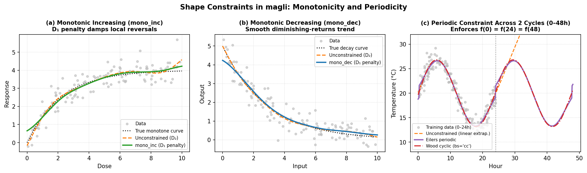

Shape Constraints
=================

magli supports shape constraints on univariate spline terms (``s()``) and on
``GAM`` / ``LinGAM``.  In ``backend='eilers'``, monotonicity and convexity
constraints are enforced via ``pyGAM``'s iterative active-set asymmetric
difference penalty on violated B-spline coefficient differences, while
periodicity wraps the B-spline basis and penalty across the domain boundaries.

.. note::

   Monotonicity and convexity constraints (``mono_inc``, ``mono_dec``,
   ``convex``, ``concave``) are provided by the Eilers-Marx engine
   (``backend='eilers'``).  Periodic smooths (``constraint='periodic'``) are
   supported in both engines: via wrapped B-splines in ``backend='eilers'``
   and via cyclic cubic/P-spline bases (``bs='cc'`` / ``bs='cp'``) in
   ``backend='wood'``.

Available constraints
---------------------

+----------------+-----------------------------+----------------------------------------+
| Constraint     | Penalty                     | Effect                                 |
+================+=============================+========================================+
| ``None``       | :math:`\lambda D_2^\top     | Standard smoothness (default)          |
|                | D_2`                        |                                        |
+----------------+-----------------------------+----------------------------------------+
| ``mono_inc``   | :math:`\lambda D_2^\top     | Enforces monotonically increasing      |
|                | D_2 + C_{\text{inc}}(\beta)`| curve (:math:`\Delta\beta_j \ge 0`)    |
+----------------+-----------------------------+----------------------------------------+
| ``mono_dec``   | :math:`\lambda D_2^\top     | Enforces monotonically decreasing      |
|                | D_2 + C_{\text{dec}}(\beta)`| curve (:math:`\Delta\beta_j \le 0`)    |
+----------------+-----------------------------+----------------------------------------+
| ``convex``     | :math:`\lambda D_2^\top     | Enforces convexity (U-shaped,          |
|                | D_2 + C_{\text{cvx}}(\beta)`| :math:`\Delta^2\beta_j \ge 0`)         |
+----------------+-----------------------------+----------------------------------------+
| ``concave``    | :math:`\lambda D_2^\top     | Enforces concavity (∩-shaped,          |
|                | D_2 + C_{\text{ccv}}(\beta)`| :math:`\Delta^2\beta_j \le 0`)         |
+----------------+-----------------------------+----------------------------------------+
| ``periodic``   | Circular                    | Enforces :math:`f(a) = f(b)` with      |
|                | :math:`\lambda D_2^\top     | wrapped basis and penalty (both        |
|                | D_2` / cyclic               | backends)                              |
+----------------+-----------------------------+----------------------------------------+

   Effect of shape constraints on noisy data: (left) ``constraint='mono_inc'``
   suppresses non-physical local dips in a dose-response curve; (centre)
   ``constraint='mono_dec'`` damps rebounds in an exponential decay curve;
   (right) ``constraint='periodic'`` (or Wood's ``bs='cc'``) joins value and
   slope seamlessly across the 24-hour cycle boundary.

How they work
-------------

**Monotonicity and convexity** combine the standard smoothness penalty
:math:`\lambda D_2^\top D_2` with an iterative active-set penalty
:math:`C(\boldsymbol{\beta})`:

.. math::

   C(\boldsymbol{\beta})
   = \lambda_{\text{con}} \, D_m^\top \operatorname{diag}\bigl(\mathbf{v}(\boldsymbol{\beta})\bigr) D_m
   + \lambda_{L2} I,

where :math:`\lambda_{\text{con}} = 10^9`, :math:`\lambda_{L2} = 10^{-3}`, and
:math:`\mathbf{v}(\boldsymbol{\beta}) \in \{0, 1\}^{K-m}` indicates which
first differences (:math:`m=1` for ``mono_inc`` / ``mono_dec``) or second
differences (:math:`m=2` for ``convex`` / ``concave``) violate the target sign:

* ``mono_inc`` penalises :math:`\Delta\beta_j = \beta_{j+1} - \beta_j < 0`.
* ``mono_dec`` penalises :math:`\Delta\beta_j = \beta_{j+1} - \beta_j > 0`.
* ``convex`` penalises :math:`\Delta^2\beta_j = \beta_{j+2} - 2\beta_{j+1} + \beta_j < 0`.
* ``concave`` penalises :math:`\Delta^2\beta_j = \beta_{j+2} - 2\beta_{j+1} + \beta_j > 0`.

Because the variation-diminishing property of B-splines guarantees that a
B-spline with monotone (or convex/concave) coefficients is itself monotone
(or convex/concave), iteratively updating :math:`\mathbf{v}(\boldsymbol{\beta})`
until convergence produces a smooth curve satisfying the directional shape
constraint.

**Periodicity** wraps the basis and penalty:

* The B-spline basis is evaluated on :math:`[0,1]` with :math:`z = z \bmod 1`,
  so the domain is a circle.
* The last :math:`k` columns are folded into the first :math:`k` columns,
  preserving the partition of unity :math:`\sum_j B_j(x) = 1` and reducing the
  coefficient count from :math:`K` to :math:`K_{\text{eff}} = K - k`.
* The circular second-difference penalty connects index :math:`K_{\text{eff}}`
  back to index 1 with :math:`C^2` continuity across the boundary.

When to use which
-----------------

* **Monotonic increasing**: dose-response curves, learning curves,
  cumulative distributions, prices vs. demand.
* **Monotonic decreasing**: diminishing returns, survival curves,
  price elasticity.
* **Convex**: cost functions, loss landscapes, risk curves.
* **Concave**: utility functions, production functions.
* **Periodic**: time-of-day effects, seasonal patterns, angular
  coordinates (compass directions).

Caveats
-------

1. **Sufficient condition via B-spline coefficients.**  Enforcing
   :math:`\Delta^2\beta_j \ge 0` on B-spline control points is a sufficient
   (slightly conservative) condition for convexity of :math:`f(x)`.

2. **Intercept is free.**  The intercept column is never penalised, so the
   overall vertical shift is unrestricted.

3. **Periodicity reduces capacity.**  A periodic spline with :math:`K=10`
   and :math:`k=3` has :math:`K_{\text{eff}} = K - k = 7` free coefficients.
   You may need slightly larger ``n_splines`` to capture the same complexity
   as a non-periodic spline.

4. **Not available for ``te()``.**  Tensor-product terms do not support
   shape constraints because the multi-dimensional penalty structure does not
   admit a simple ordered-difference formulation.  Apply constraints to the
   marginal ``s()`` terms instead.

Examples
--------

Monotonically increasing spline:

.. code-block:: python

   model = GAMCore("s(0, constraint='mono_inc') + l(1)", backend="eilers")
   model.fit(x, y)

Periodic seasonal effect::

   model = GAMCore("s(0, n_splines=12, constraint='periodic') + l(1)", backend="eilers")
   model.fit(x, y)

Single-term with monotonicity::

   model = LinGAM(n_splines=12, constraint='mono_inc', backend="eilers")
   model.fit(x, y)
