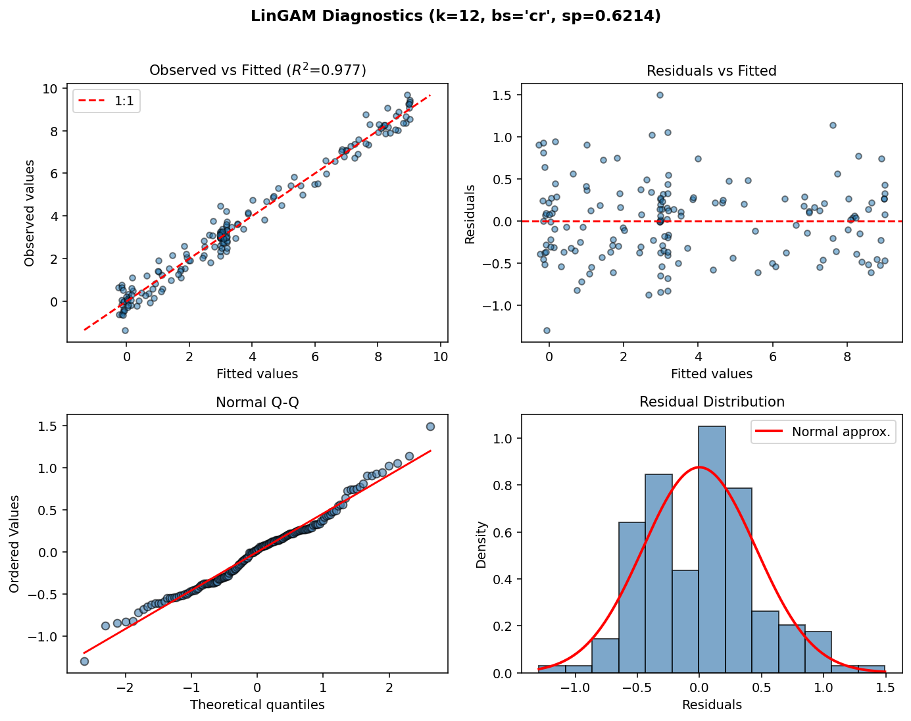
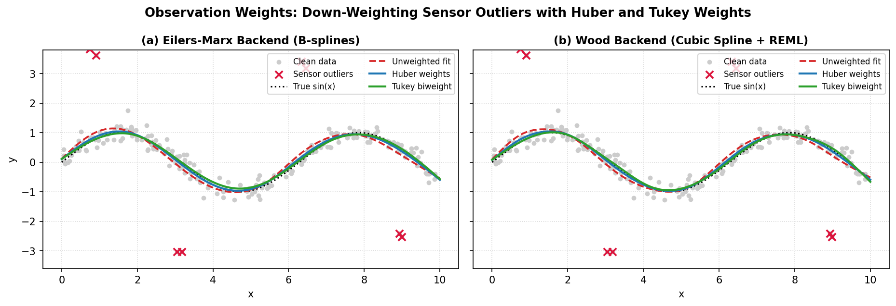

Examples
========

This chapter collects end-to-end examples demonstrating common use cases.

Runnable notebooks
------------------

Three executed notebooks live in ``examples/``. The two backend tutorials are
generated, re-executed and asserted from scratch by their companion scripts, so
they can never drift away from the library:

* `examples/gam_tutorial.ipynb`_ (``create_tutorial_notebook.py``): a hands-on
  tour across both backends: underfitting vs. overfitting, EDF interpretation,
  2-D tensor interactions, and shape constraints.
* `examples/wood_backend_math_tutorial.ipynb`_ (``create_wood_math_notebook.py``):
  the Wood backend's mathematics and workflow: the basis zoo, ``S.scale`` and
  sum-to-zero absorption, continuous REML/GCV optimisation, Wood (2013)
  approximate F-tests, and a full engineering case study.
* `examples/eilers_backend_math_tutorial.ipynb`_ (``create_eilers_math_notebook.py``):
  the Eilers-Marx backend's mathematics and workflow: De Boor B-splines,
  difference penalties, the SVD data-augmentation solver, GCV grid search,
  shape constraints, and the same case study end to end.

Regenerating a notebook needs the Jupyter stack (``nbformat``, ``nbclient``,
``ipykernel``): install it with ``pip install -e .[notebooks]`` from the
repository root.

.. code-block:: bash

   python examples/create_wood_math_notebook.py
   python examples/create_eilers_math_notebook.py

.. _examples/gam_tutorial.ipynb: https://github.com/dacts23/magli/blob/main/examples/gam_tutorial.ipynb
.. _examples/wood_backend_math_tutorial.ipynb: https://github.com/dacts23/magli/blob/main/examples/wood_backend_math_tutorial.ipynb
.. _examples/eilers_backend_math_tutorial.ipynb: https://github.com/dacts23/magli/blob/main/examples/eilers_backend_math_tutorial.ipynb

Basic regression & residual diagnostics
---------------------------------------

.. code-block:: python

   import numpy as np
   from magli import GAMCore

   np.random.seed(42)
   n = 300
   x = np.column_stack([
       np.random.uniform(0, 10, n),
       np.random.uniform(0, 5, n),
   ])
   y = np.sin(x[:, 0]) + 0.3 * x[:, 1] + np.random.normal(0, 0.2, n)

   model = GAMCore("s(0, n_splines=12) + l(1)", backend="eilers")
   model.fit(x, y)

   print("GCV  =", model.statistics_['GCV'])
   print("EDF  =", model.statistics_['edof'])
   print("AIC  =", model.aic())
   print("BIC  =", model.bic())
   print("R²   =", model.deviance_explained())

   y_hat = model.predict(x)
   ci = model.confidence_intervals(x)

   fig_decomp, axes_decomp = model.plot_decomposition(x, y)
   fig_diag, axes_diag = model.plot_diagnostics(x, y)

   Output of ``model.plot_diagnostics(x, y)``: Observed vs. Fitted values,
   Residuals vs. Fitted values, Residual Histogram, and Normal Q-Q plot.

Grid search with selective terms
--------------------------------

.. code-block:: python

   model = GAMCore("s(0) + s(1) + te(0, 1)", backend="eilers")
   model.gridsearch(
       x, y,
       lam_grids=[np.logspace(-2, 2, 5)],
       n_splines_grids=[np.arange(5, 13, 2)],
       search_terms=['s'],  # only tune the univariate splines
   )

   print("Best s(0): K =", model._terms[0].n_splines,
         "lam =", model._terms[0].lam)

Categorical + interaction
-------------------------

.. code-block:: python

   np.random.seed(42)
   n = 400
   x = np.column_stack([
       np.random.uniform(0, 10, n),                    # continuous
       np.random.uniform(0, 5, n),                      # continuous
       np.random.choice([0, 1, 2], n).astype(float),   # categorical
   ])
   y = (
       np.sin(x[:, 0])
       + 0.3 * x[:, 1]
       + np.where(x[:, 2] == 0, -1, np.where(x[:, 2] == 1, 0, 2))
       + np.random.normal(0, 0.3, n)
   )

   model = GAMCore("s(0) + l(1) + f(2)", backend="eilers")
   model.fit(x, y)
   model.gridsearch(x, y)

   # Partial dependence for each term
   pdep_s = model.partial_dependence(0, x)
   pdep_l = model.partial_dependence(1, x)
   pdep_f = model.partial_dependence(2, x)

Wood backend & summary table
-----------------------------

.. code-block:: python

   import numpy as np
   from magli import GAM

   np.random.seed(42)
   n = 200
   x = np.linspace(0, 1, n)
   y = np.sin(2 * np.pi * x) + np.random.normal(0, 0.15, n)

   # In Wood backend (the default), lambda (sp) is estimated automatically via REML
   model = GAM(k=10, bs="cr", backend="wood")
   model.fit(x, y)

   # Formatted summary table (Wood 2013)
   print(model.summary())
   print("Deviance explained:", model.deviance_explained())

Monotonic dose-response
-----------------------

.. code-block:: python

   np.random.seed(42)
   dose = np.random.uniform(0, 10, 150)
   response = 5 * (1 - np.exp(-0.4 * dose)) + np.random.normal(0, 0.3, 150)

   model = GAM(n_splines=12, constraint='mono_inc', backend="eilers")
   model.fit(dose, response)

   # Grid search respects the monotonic constraint
   model.gridsearch(dose, response)

   fig, axes = model.plot_decomposition(dose, response)

Periodic seasonal pattern
-------------------------

.. code-block:: python

   np.random.seed(42)
   hour = np.random.uniform(0, 24, 300)
   temp = (
       20
       + 8 * np.sin(2 * np.pi * hour / 24)
       + 3 * np.random.normal(0, 1, 300)
   )

   # Periodic constraint encloses the daily cycle
   model = GAM(n_splines=12, constraint='periodic', backend="eilers")
   model.fit(hour, temp)

   # Predict across a full day
   hour_grid = np.linspace(0, 24, 200)
   temp_hat = model.predict(hour_grid)

   # 6 AM and 6 PM should have the same prediction as 30 h and 42 h
   assert np.isclose(model.predict([6]), model.predict([30]), atol=1e-3)

Observation weights for outlier resistance
------------------------------------------

.. code-block:: python

   import numpy as np
   from magli import GAM

   np.random.seed(42)
   x = np.linspace(0, 10, 150)
   y = np.sin(x) + np.random.normal(0, 0.18, len(x))
   y[[20, 55, 95, 130]] += np.array([3.2, -3.0, 3.4, -2.8])  # sensor spikes

   # Initial fit and MAD-scaled Huber weights
   m0 = GAM(k=14, bs="cr", backend="wood").fit(x, y)
   resid = y - m0.predict(x)
   mad_sigma = 1.4826 * np.median(np.abs(resid - np.median(resid)))
   u = np.abs(resid) / (mad_sigma + 1e-12)
   weights = np.where(u <= 1.345, 1.0, 1.345 / u)

   # Refit with observation weights (supported in both backends)
   m_weighted = GAM(k=14, bs="cr", backend="wood").fit(x, y, weights=weights)

   Down-weighting sensor spikes via ``weights=...`` prevents outliers from
   pulling the smooth curve in both the Eilers-Marx and Wood backends.

2-D tensor interaction
----------------------

.. code-block:: python

   np.random.seed(42)
   n = 500
   x = np.column_stack([
       np.random.uniform(0, 10, n),
       np.random.uniform(0, 5, n),
   ])
   y = (
       np.sin(x[:, 0]) * np.cos(x[:, 1])
       + 0.5 * x[:, 0]
       + np.random.normal(0, 0.3, n)
   )

   model = GAMCore("s(0) + s(1) + te(0, 1, n_splines=6)", backend="eilers")
   model.fit(x, y)
   model.gridsearch(x, y)

   # te(0,1) captures the interaction that s(0)+s(1) cannot
   pdep_te = model.partial_dependence(2, x)

   fig, axes = model.plot_decomposition(x, y)
