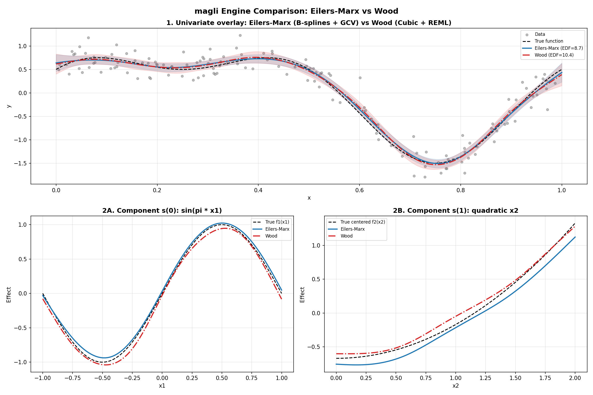

.. _part-comparison:

Part IV: Backends Compared
===========================

.. _section-backends-compared:

Two Philosophies for the Same Goal
----------------------------------

Generalized Additive Models share a single, compelling motivation: they discover non-linear relationships in data without forcing you into an uninterpretable black box. Both engines in ``magli`` fit the exact same model to your data, minimizing the same penalized sum of squares:

.. math::

   \|\mathbf{y} - X\boldsymbol{\beta}\|^2 + \boldsymbol{\beta}^\top S_{\boldsymbol{\lambda}} \boldsymbol{\beta}.

Here, the first term measures how closely the fitted curve tracks the observed data, while the second term imposes a penalty on unnecessary wiggles. Yet Paul Eilers and Simon Wood arrived at this equation from completely different starting points, and those origins shape how each backend behaves in practice.

Paul Eilers approached smoothing from an engineering and chemometrics perspective. In chemometrics, datasets often consist of smooth spectroscopic curves measured across hundreds of contiguous wavelengths. Eilers wanted an intuitive, transparent system built out of identical, evenly spaced building blocks that could be evaluated rapidly and controlled with simple difference penalties. His philosophy prioritizes computational directness, numerical stability on difficult grids, and straightforward geometric controls such as monotonicity.

Simon Wood approached the problem as a mathematical statistician. He recognized that non-linear smoothing could be recast as a generalized linear mixed model, where the wiggliness penalty acts as a Gaussian prior on the regression coefficients. Wood wanted an entire inferential ecosystem: automatic parameter selection that scales to dozens of terms, a rich catalog of specialized basis functions tailored to different coordinate geometries, and formal hypothesis tests with p-values matching classical linear regression tables.

Neither philosophy is universally better; each excels in different modeling scenarios.

   A head-to-head comparison illustrating how the two backends handle core modeling tasks: (1) univariate smooth estimation, (2) discrete GCV grid search versus continuous REML optimization, (3) monotonic shape constraints, (4) cyclic boundary wrapping, (5) outlier down-weighting, and (6) 2-D interaction surfaces with independent coordinate smoothing.

The Choice of Basis: Uniform LEGO Bricks vs. Tailored Geometries
----------------------------------------------------------------

The first fundamental divergence between the backends is how they translate an input variable into a set of basis curves.

The Eilers-Marx backend bets entirely on a single basis family: the uniform B-spline. Instead of debating where knots should sit, Eilers-Marx places a uniform grid of bell-shaped cubic B-spline bumps across the entire range of your predictor. Every basis function has the exact same width and shape, overlapping with its immediate neighbors to form what mathematicians call a partition of unity (the bumps sum to exactly 1.0 at every point along the axis). You typically assign between 10 and 40 basis functions to a term, and you leave the knot locations alone. The difference penalty handles all the work of deciding how flexible the curve should be. This setup is predictable, robust, and easy to visualize, functioning very much like building a curve out of identical LEGO bricks.

Simon Wood argued that physical data comes in geometries where uniform B-splines are suboptimal. The Wood backend therefore provides an entire zoo of basis families:

* Thin plate regression splines (``tp`` and shrinkage variant ``ts``) solve a continuous differential equation representing the bending energy of a thin sheet of metal. They require no knot placement whatsoever and generalize naturally to two or three spatial dimensions, making them the gold standard for spatial coordinates and geographic data.
* Cubic regression splines (``cr`` and shrinkage variant ``cs``) place knots at sample quantiles of the predictor variable. If ninety percent of your data is concentrated in a narrow band with only sparse points in the tails, quantile placement automatically concentrates basis resolution where you have the most evidence, rather than wasting parameters in empty regions.
* Cyclic cubic splines (``cc``) and cyclic P-splines (``cp``) tie the two ends of the domain together. For cyclic predictors such as hour of the day, day of the year, or wind direction, these bases enforce matching values and matching derivatives at the boundaries, ensuring your fitted curve wraps smoothly around the clock without artificial edge kinks.
* Random effect splines (``re``) treat categorical groups with many levels as exchangeable draws from a zero-mean normal distribution, applying pure ridge shrinkage to pool estimates toward the global mean.

In short, Eilers-Marx chooses one simple, uniform tool and regularizes it, whereas Wood offers a curated toolkit tailored to specific physical and spatial geometries.

Tuning Smoothness: Discrete Grid Sweeps vs. Continuous Mountain Climbing
------------------------------------------------------------------------

Once you choose a basis, you must decide how much to penalize wiggles. If the penalty parameter :math:`\lambda` is too small, the curve chases random noise; if :math:`\lambda` is too large, it flattens into a straight line. The two backends find the optimal :math:`\lambda` through fundamentally different mechanisms.

In the Eilers-Marx backend, smoothing parameter selection is treated as an explicit experimental sweep. You provide a grid of candidate :math:`\lambda` values (for example, eleven log-spaced points from 0.001 to 1000), and the algorithm evaluates Generalized Cross-Validation (GCV) at every candidate. Because candidate points are completely independent, the search evaluates them in parallel across your CPU cores. The major advantage of this approach is visual transparency: you can plot the entire U-shaped GCV curve, inspect whether the chosen minimum is sharp or ambiguous, and explore alternative configurations. The limitation is combinatorial scaling: if you have four different smooth terms and want to search ten candidate values for each, a full grid requires :math:`10^4 = 10,000` evaluations, which quickly becomes computationally prohibitive.

The Wood backend solves this by turning parameter selection into an internal optimization problem. Because the penalty acts as a Gaussian prior on the coefficients, the marginal likelihood of the data can be evaluated using Restricted Maximum Likelihood (REML). Instead of evaluating a discrete grid, Wood optimizes :math:`\log \lambda` continuously using exact analytic gradients. The algorithm calculates the slope of the REML surface directly from the existing matrix decomposition and steps uphill toward the optimum using L-BFGS-B or Brent's method. This means you never have to specify search ranges or guess candidate values; the backend finds the continuous optimum on its own. More importantly, this continuous optimization scales effortlessly to models with multiple terms, updating a dozen independent smoothing parameters simultaneously in a fraction of a second.

Numerical Solvers: SVD Data Augmentation vs. Cholesky Efficiency
-----------------------------------------------------------------

Behind every GAM fit lies a system of linear equations. The choice of solver determines how fast the model fits and how reliably it behaves when data is collinear or sparse.

The Eilers-Marx backend relies on the Singular Value Decomposition (SVD) applied to a data-augmented system. In standard least-squares regression, solving the normal equations :math:`(X^\top X + \lambda D^\top D)\boldsymbol{\beta} = X^\top \mathbf{y}` requires computing :math:`X^\top X`. Doing so squares the condition number of the design matrix, which can turn an ill-conditioned problem into an unstable one, particularly when :math:`\lambda` approaches zero or when predictors correlate strongly. Eilers-Marx circumvents this by stacking the difference penalty directly underneath the design matrix, forming an augmented matrix with :math:`X` on top and :math:`\sqrt{\lambda}D` on the bottom. Performing an SVD directly on this stacked system solves the penalized problem without ever forming :math:`X^\top X`. The solver never squares condition numbers, remains stable across the entire range of :math:`\lambda`, and degrades gracefully even when parts of the design matrix are singular.

The Wood backend uses a QR factorization of the design matrix followed by a Cholesky decomposition of the penalized system :math:`R^\top R + S_{\boldsymbol{\lambda}} = L L^\top`. A Cholesky solve requires roughly one-third the floating-point operations of a full SVD, making each objective evaluation significantly faster. More importantly for Wood's optimizer, both the determinant of the penalized system and the effective degrees of freedom fall directly out of the diagonal elements of the Cholesky factor :math:`L`. This allows Wood to evaluate the REML score and its analytic gradient in a single rapid pass at each iteration of the optimizer.

Identifiability and Zero-Centering: Implicit Offsets vs. Absorbed Constraints
-----------------------------------------------------------------------------

A subtle challenge in additive models is identifiability. If you add 10 to a smooth term :math:`f_1(x_1)` and subtract 10 from the global intercept :math:`\beta_0`, the model's total predictions remain completely identical. Without a clear rule, the division of labor between the intercept and the smooth terms becomes arbitrary.

The Eilers-Marx backend handles this division implicitly. Because a uniform B-spline basis spans constant functions, the second-difference penalty shrinks the basis coefficients toward each other, while the unpenalized intercept column absorbs whatever global vertical offset remains. When you examine partial dependence plots from Eilers-Marx, the curves capture the correct shape, but their vertical position often depends on the overall baseline of the dataset.

The Wood backend enforces identifiability explicitly before fitting begins. It computes the sample mean of every basis column across the training set and constructs a linear sum-to-zero constraint. Using a Householder QR decomposition of this constraint, it projects the basis onto the exact subspace where every column averages to zero. This projection guarantees that every smooth term has an empirical mean of zero across your dataset. The intercept owns the entire baseline, and each smooth term owns strictly its deviations from that baseline. When you plot a partial dependence curve in Wood, it is centered around zero by mathematical construction.

Statistical Inference and Hypothesis Testing
--------------------------------------------

For many practitioners, fitting a curve is only half the battle; the other half is reporting whether the predictor has a statistically meaningful effect.

The Eilers-Marx backend takes a conservative, pragmatic approach to inference. It reports effective degrees of freedom (EDF), Generalized Cross-Validation scores, and frequentist confidence bands on the fitted curve. However, it deliberately avoids reporting p-values for individual smooth terms. In penalized spline models, defining the reference distribution for an ANOVA-style test statistic has historical mathematical subtleties, and Eilers-Marx avoids making assumptions that might mislead users into overinterpreting significance levels. Model comparison is handled by comparing GCV scores or AIC values across alternative specifications.

The Wood backend fully embraces the Bayesian mixed-model interpretation. By viewing the penalty as a Gaussian prior, it constructs a Bayesian posterior covariance matrix alongside the frequentist sandwich covariance. Using Simon Wood's 2013 moment-matching derivation, it computes an approximate F-statistic and an associated p-value for each smooth term. This tests the null hypothesis that the smooth function is identically zero across its entire range. If you need to submit an empirical paper or present results to stakeholders who expect standard regression tables with significance stars and p-values, the Wood backend provides that output directly through its summary method.

Physical Shape Constraints: When Domain Knowledge Trumps Noise
--------------------------------------------------------------

In many engineering, medical, and economic problems, physical laws or established domain knowledge dictate how a curve must behave. For example, cumulative drug toxicity must not decrease as dosage increases, soil strength must increase with compaction, and material wear must accumulate over time. When data is noisy, an unconstrained algorithm might fit local dips or reversals that violate physical reality.

The Eilers-Marx backend handles this naturally through soft shape constraints. Because B-spline basis functions are localized and strictly ordered from left to right along the input axis, enforcing monotonicity is as simple as switching from a second-difference penalty to a first-difference penalty:

.. math::

   P = \lambda D_1^\top D_1.

This penalizes adjacent coefficient reversals, encouraging the fitted curve to move steadily upward (``mono_inc``) or downward (``mono_dec``) without clipping or step-function artifacts. A similar second-difference formulation provides soft convexity (``convex``) and concavity (``concave``) pushes.

The Wood backend does not support monotonic or convex constraints. Projecting smooths into constrained parameter cones conflicts with Wood's continuous REML gradient machinery and its sum-to-zero basis projections. Both backends support periodic boundary conditions, but if your application requires physical monotonicity or convexity, Eilers-Marx is the engine equipped for the job.

How to Choose the Right Backend for Your Problem
------------------------------------------------

When you sit down to model a real dataset with ``magli``, use this practical guide to choose your starting backend:

**Choose the Wood backend (the default) when:**

* You have a multi-term model with several continuous predictors and you want each term's smoothing parameter tuned automatically without configuring grids.
* You need formal summary tables with approximate F-tests, p-values, and adjusted :math:`R^2` to include in an academic paper, technical report, or stakeholder presentation.
* Your predictors include 2-D spatial coordinates, geographical locations, or cyclic variables that benefit from specialized thin plate or cyclic cubic splines.
* You are transitioning code or workflows from R's ``mgcv`` package and want numerical parity with its established methodology.

**Choose the Eilers-Marx backend when:**

* Physical domain knowledge dictates that a relationship must be monotonically increasing, monotonically decreasing, convex, or concave.
* You want to inspect the entire GCV landscape across a grid of candidate parameters to understand how sensitive your model is to the choice of smoothing.
* You want a simple, transparent mental model where every term is built from uniform B-spline bumps and difference penalties.
* You are teaching or learning how penalized splines function under the hood, where the step-by-step matrix augmentation and SVD solver can be inspected clearly.

When you are unsure, fit both backends on the same data and compare their decomposition plots. Because both engines minimize the same penalized objective, their fitted curves should tell the same substantive story about your data. If the two backends disagree noticeably, it is almost always an informative diagnostic clue, signaling that GCV has settled into an under-smoothed local dip, or that the basis dimension was set too small for the complexity of the signal.
