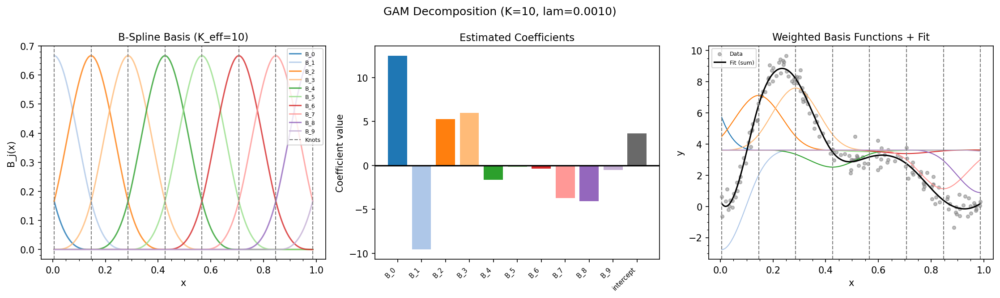
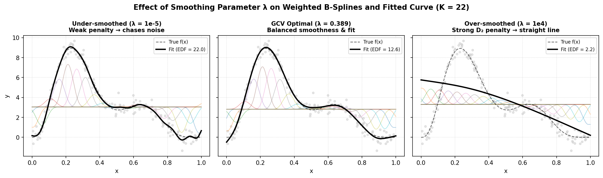
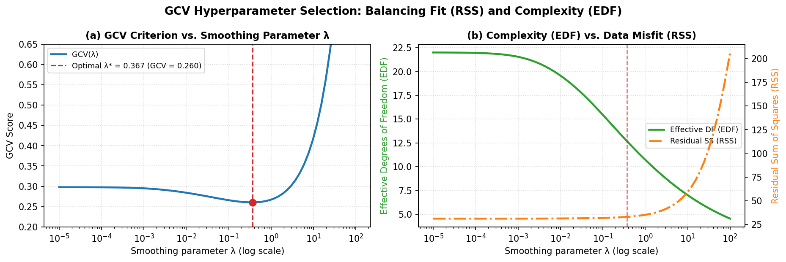

.. _part-eilers:

Part II: The Eilers & Marx Backend
===================================

.. _section-eilers-design:

How the Eilers-Marx backend thinks
----------------------------------

The Eilers-Marx backend (``backend='eilers'``) is the minimalist design: **one
basis family, one solver, one criterion, chosen well.**  Every smooth term
is a uniform cubic B-spline; smoothness is charged by a difference penalty;
the one free knob, the smoothing parameter :math:`\lambda`, is chosen by
evaluating a discrete grid of candidates and keeping the one with the best
Generalised Cross Validation (GCV) score.

The whole pipeline is:

.. math::

   \text{formula}
   \;\to\;
   \underbrace{B\text{-spline bases } X}_{\S 1}
   \;\to\;
   \underbrace{\text{penalty } P}_{\S 2}
   \;\to\;
   \underbrace{\text{solve } (X^\top X + P)\hat\beta = X^\top y}_{\S 3--4}
   \;\to\;
   \underbrace{\text{score with GCV, pick best } (K, \lambda)}_{\S 5--6}.

Each step is a section below.  The design bets on three ideas:

1. **Uniform B-splines are good enough.**  A cubic B-spline with
   10-20 basis functions can approximate almost any smooth engineering
   relationship; the exact knot placement rarely matters at that
   resolution.
2. **Grid search is honest.**  Instead of optimising :math:`\lambda`
   continuously (which requires derivatives of criteria that may have
   flat or multiple minima), evaluate a finite, user-visible grid and
   pick the winner.  Slow in theory, fast in practice once you precompute
   cleverly (:ref:`grid search<section-grid-search-mechanics>`).
3. **SVD is the safest solver.**  Never form :math:`X^\top X` explicitly;
   work with a square-root of the penalised system instead
   (:ref:`SVD solver<section-svd-solver>`).

Identifiability in this backend is *implicit*: the intercept column is
unpenalised and absorbs the overall level, and each penalty leaves its own
null space (constant and linear trends for the default penalty) uncharged,
so the decomposition into intercept + smooths is well defined in practice.
There is no explicit centering constraint, a deliberate simplification we
compare against Wood's approach later.

.. _section-bsplines:

B-spline bases: building curves from building blocks
----------------------------------------------------

If we want :math:`f(x)` to be a *smooth, flexible curve*, we need a
way to represent it mathematically.

**Why not just use a high-degree polynomial?**  A degree-20 polynomial can
wiggle a lot, but when you fit it to data every point in one corner of the
plot affects the curve *everywhere*.  You get wild oscillations (Runge's
phenomenon).  Polynomials are globally coupled: change one coefficient and
everything changes.

**The key insight of B-splines**: build the curve from *localised* building
blocks.  Each block (basis function) is nonzero only in a small region.
Adjusting a block only changes the curve in its neighbourhood, not across
the whole domain.  This is called **compact support**.

Think of LEGO bricks.  A long, curved wall isn't built from one flexible
piece: it is built from many small, rigid bricks each responsible for a
tiny segment.  The bricks overlap slightly at the edges for smoothness.
B-spline basis functions are the mathematical equivalent: each one is a
smooth "bump" that covers a few neighbouring data points.  When you stack
them with different heights (coefficients :math:`\beta_j`), you get any
smooth shape you want:

.. math::

   f(x) = \sum_{j=1}^K \beta_j \, B_j(x).

Each :math:`B_j(x)` is one basis function; :math:`\beta_j` is how tall
you make it; :math:`K` is how many bricks you use (``n_splines`` or ``k`` in the
API).

   Single-term ``LinGAM.plot_decomposition`` (Eilers-Marx backend): **(left)** uniform cubic
   B-spline basis bumps :math:`B_j(x)` and interior knots, **(middle)** estimated coefficients
   :math:`\hat\beta_j` and intercept, **(right)** scaled basis functions :math:`\hat\beta_j B_j(x) + \hat\beta_0`
   summing to the fitted curve.

**The De Boor recursion.**  A B-spline of polynomial degree :math:`k`
(order :math:`k+1`, ``spline_order=k`` in the API) is built recursively.
Given data :math:`x \in [x_{\min}, x_{\max}]`, we map to :math:`[0, 1]`:

.. math::

   z = \frac{x - x_{\min}}{x_{\max} - x_{\min}}.

Uniform interior knots (:math:`1 + K - k` points) divide :math:`[0, 1]`
into :math:`K - k` segments:

.. math::

   \tau_0 = 0, \; \tau_1, \dots, \tau_{K-k} = 1.

The augmented knot sequence extends :math:`k` knots beyond each boundary
to handle the edges.

Start with order-1 (piecewise constant) bases:

.. math::

   B_{i,1}(z) = \mathbf{1}_{[\tau_i, \tau_{i+1})}(z).

Then recursively blend for orders :math:`m = 2, \dots, k+1`:

.. math::

   B_{i,m}(z)
   = \frac{z - \tau_i}{\tau_{i+m-1} - \tau_i} \, B_{i,m-1}(z)
   + \frac{\tau_{i+m} - z}{\tau_{i+m} - \tau_{i+1}} \, B_{i+1,m-1}(z).

Each blend raises the order by one and shrinks the basis count by one, so
:math:`K` functions of order :math:`k+1` come out at the end.  The result
is an :math:`n \times K` design matrix :math:`B`.  Each row sums to 1 (the
bricks tile the space) and each column has compact support (localised
bumps).

**Why cubic?**  magli defaults to ``spline_order=3``, which the recursion
above turns into basis functions of order :math:`k+1 = 4`: cubic
polynomials, degree 3.  Cubic is the lowest degree that gives *continuous
second derivatives*, so the curve looks smooth to the human eye.  Lower
orders look jagged; higher orders increase computation without visible
benefit.

**Linear extrapolation.**  Outside :math:`[0,1]`, B-splines can oscillate
or collapse to zero, which is not useful for prediction beyond the training range.
magli replaces the B-spline values with a linear extension using the
boundary derivative:

.. math::

   f(z) \approx f(0) + f'(0) \, z \quad (z < 0),
   \qquad
   f(z) \approx f(1) + f'(1) \, (z-1) \quad (z > 1).

The derivative :math:`f'(0)` is computed analytically from the order-:math:`k`
bases saved during the last step of the recursion, using the standard
B-spline derivative formula :math:`B'_{i,k+1} = k
\bigl( B_{i,k}/\Delta\tau - B_{i+1,k}/\Delta\tau \bigr)`.

**Periodic basis.**  When ``constraint='periodic'``, the domain wraps
around: the input is taken modulo 1 and the first :math:`k-1` columns fold
into the last :math:`k-1`, enforcing :math:`f(0) = f(1)` and reducing the
coefficient count from :math:`K` to :math:`K_{\text{eff}} = K - k + 1`.

.. _section-penalties:

Penalties: why flexibility needs a cost
---------------------------------------

Suppose we give the model :math:`K = 30` basis functions.  It could fit the
data almost *perfectly*, including every random noise wiggle.  When we then
predict on new data, the model falls apart.  This is **overfitting**.

The solution is to penalise complexity.  We don't forbid wiggles; we charge
a tax for them.  The model can still wiggle, but only if doing so improves
the fit enough to be worth the tax.

**The penalised least-squares objective** is:

.. math::

   \underbrace{\|\mathbf{y} - X\boldsymbol{\beta}\|^2}_{\text{fit to data}}
   \;+\;
   \underbrace{\boldsymbol{\beta}^\top P \boldsymbol{\beta}}_{\text{complexity penalty}}.

The first term rewards fitting the training data closely.  The second term
punishes certain patterns in the coefficients.  The smoothing parameter
:math:`\lambda` (``lam`` in the API) controls the tax rate:

* :math:`\lambda = 0`: no penalty; the curve can be as wiggly as the
  basis allows.  Equivalent to unpenalised regression.
* :math:`\lambda \to \infty`: infinite penalty; the curve is forced to
  be as smooth as possible (a straight line for second-difference penalties).
* :math:`0 < \lambda < \infty`: a balance.  magli uses grid search to
  find the :math:`\lambda` that minimises GCV.

   How :math:`\lambda` shapes the fit (:math:`K = 22`): **(left)** weak penalty
   (:math:`\lambda = 10^{-5}`) lets adjacent B-splines oscillate to chase noise;
   **(middle)** GCV-optimal :math:`\lambda` balances smoothness and fidelity;
   **(right)** strong penalty (:math:`\lambda = 10^4`) forces the second differences
   to zero, collapsing the curve onto its linear null space (:math:`\text{EDF} \approx 2`).

**What each penalty does to the curve:**

*Second-difference penalty (default):*  Penalises the *curvature* (second
derivative) of :math:`f(x)`.  A straight line has zero curvature, so it
costs nothing.  Wiggles cost a lot.  This produces the visually "smooth"
curves we expect.

.. math::

   D_2 = \begin{pmatrix}
   1 & -2 & 1 &        &   \\
     &  1 & -2 & 1     &   \\
     &    & \ddots & \ddots & \ddots
   \end{pmatrix}_{(K-2) \times K},
   \qquad
   P = \lambda \, D_2^\top D_2.

*First-difference penalty (``mono_inc`` / ``mono_dec``):*  Penalises
*changes* between adjacent coefficients, :math:`\sum_i (\beta_{i+1} -
\beta_i)^2` (a discrete first-derivative penalty whose null space is
constants only).  Because adjacent coefficients are pulled toward each
other, local oscillations are damped so a strong underlying upward or
downward trend in the data remains monotone.

.. math::

   D_1 = \begin{pmatrix}
   -1 & 1 &   &   \\
      & -1 & 1 &   \\
      &    & \ddots & \ddots
   \end{pmatrix}_{(K-1) \times K},
   \qquad
   P = \lambda \, D_1^\top D_1.

*Circular second-difference (periodicity):*  The second-difference operator
wraps around, connecting the last coefficient back to the first: the
mathematical equivalent of gluing the two ends of the curve together.

*Ridge penalty:*  For factor terms (and linear terms, if penalised),
:math:`P = \lambda I_K`.  This is a "shrink-toward-zero" penalty that pulls
all coefficients toward zero by the same amount.  (Linear ``l()`` terms
default to :math:`\lambda = 0`: unpenalised.)

**An honest caveat about "constraints".**  The ``constraint=`` argument maps
both ``'mono_inc'`` and ``'mono_dec'`` to the same sign-symmetric
first-difference penalty :math:`\lambda D_1^\top D_1` (which shrinks toward
a flat constant and does not distinguish :math:`+` from :math:`-` slopes),
and maps both ``'convex'`` and ``'concave'`` to the standard
second-difference penalty :math:`\lambda D_2^\top D_2` (identical to
``constraint=None``).  Only ``constraint='periodic'`` alters the basis and
penalty structure asymmetrically (wrapping the basis and circularly
connecting :math:`D_2`).  Enforcing true directional monotonicity or
convexity/concavity requires an asymmetric or inequality-constrained solver.

**The role of** :math:`\boldsymbol{\lambda}` **cannot be overstated.**
:math:`\lambda` determines how much information the model extracts from the
data vs. how much it imposes from the smoothness prior.  Too small →
overfitting (the model chases noise).  Too large → underfitting (the model
misses real patterns).  Grid search finds the Goldilocks value
automatically.

.. _section-svd-solver:

The SVD data-augmentation solver
--------------------------------

Once we have the design matrix :math:`X` and the penalty :math:`P`, we
need to find the coefficients :math:`\hat{\boldsymbol{\beta}}` that
minimise the penalised objective.

**The naive approach** forms the normal equations:

.. math::

   (X^\top X + P)\hat{\boldsymbol{\beta}} = X^\top \mathbf{y}.

This is mathematically correct but numerically dangerous.  Forming
:math:`X^\top X` squares the condition number: if :math:`X` has a
condition number of :math:`10^4`, then :math:`X^\top X` has :math:`10^8`.
On a computer with 16-digit precision, this leaves very little room for
error.

**The data-augmentation trick** treats the penalty as "fake data":

.. math::

   \begin{pmatrix} X \\ E \end{pmatrix} \boldsymbol{\beta}
   \approx \begin{pmatrix} \mathbf{y} \\ \mathbf{0} \end{pmatrix},

where :math:`E` satisfies :math:`E^\top E = P + \sqrt{\varepsilon}\, I` (a tiny
ridge :math:`\sqrt{\varepsilon}` with machine epsilon :math:`\varepsilon` ensures
positive definiteness even when :math:`\lambda = 0`; in ``solve_pirls`` :math:`E`
is the transposed Cholesky factor of :math:`P + \sqrt{\varepsilon}\, I`).  The top
block says "fit the actual data."  The bottom block says "keep the coefficients
small in the penalised directions."

Solving this augmented system is equivalent to the penalised normal
equations, but **never forms** :math:`X^\top X`.  Instead, magli uses:

1. **QR decomposition** of :math:`X = QR`.  :math:`R` is small
   (:math:`m \times m`, where :math:`m = \sum K_j + 1`), so subsequent
   operations are cheap even when :math:`n` is huge.

2. **SVD of the stacked matrix** :math:`[R; E] = U \Sigma V^\top`.  The
   singular value decomposition is the most numerically stable way to
   factor a matrix; it exposes the "directions" in which the data has
   information and the directions it doesn't.

3. **Solution operator** :math:`B_{\text{solve}} = V \Sigma^{-1} U_1^\top
   Q^\top` so that :math:`\hat{\boldsymbol{\beta}} = B_{\text{solve}}
   \mathbf{y}`.  This is saved and reused for covariance, EDF, and
   confidence intervals with no re-solving needed.  (:math:`U_1` is the top
   :math:`m \times m` block of :math:`U`, the part corresponding to the
   data block :math:`R`.)

The SVD approach is especially important when :math:`\lambda` is very small
(the near-unpenalised case) or very large (near-zero coefficients), where
the normal equations become ill-conditioned.  By working with the
square-root of :math:`X^\top X + P` rather than the matrix itself, the SVD
solver stays accurate across the entire range of :math:`\lambda`.

.. _section-edf:

Effective Degrees of Freedom (EDF)
----------------------------------

In ordinary linear regression with :math:`p` predictors, the model uses
exactly :math:`p` degrees of freedom: one per coefficient.  You can think
of each degree of freedom as the model's ability to "move" in one
independent direction to fit the data.

**Penalised splines blur this picture.**  The model *has* :math:`K`
coefficients (basis functions), but the penalty restricts how freely each
one can move.  A heavily penalised coefficient is "shrunken" toward its
neighbours: it costs an entire degree of freedom to include, but the
penalty means you only use a fraction of it.

The EDF measures **how many independent directions the fitted model actually
explores.**  It is always between 0 and :math:`K`, and usually much closer
to the number of "real features" in the data.

Mathematically, the EDF is the trace of the influence (hat) matrix:

.. math::

   \text{EDF} = \operatorname{tr}(H),
   \qquad
   H = X (X^\top X + P)^{-1} X^\top.

Using the SVD augmentation from the solver, this simplifies to:

.. math::

   \text{EDF} = \sum_{i} \sigma_i(U_1)^2 = \|U_1\|_F^2,

where :math:`U_1` is the data block of the SVD's left singular vectors.
Why the equality holds: with :math:`X = QR` and
:math:`[R;E] = U\Sigma V^\top`, the hat matrix factors as
:math:`H = Q U_1 U_1^\top Q^\top`, so its trace is
:math:`\operatorname{tr}(U_1^\top Q^\top Q U_1) = \|U_1\|_F^2`.  This is
computed in a single NumPy call with no matrix inversion.

**What EDF tells you in practice:**

* ``EDF ≈ 2``: the term is essentially a straight line (2 df = intercept +
  slope).
* ``EDF ≈ K``: the penalty is very weak; the term is using nearly all its
  basis functions.
* ``EDF << K`` with good fit: the penalty is working well: the data has a
  smooth trend that the model captures with few effective parameters.
* ``EDF`` growing while GCV stays flat: you're overfitting: the extra
  wiggle doesn't help prediction.

Per-direction EDF is stored in ``statistics_['edof_per_coef']``:

.. math::

   \text{EDF}_j = \sum_i U_{1,ji}^2 = (U_1 U_1^\top)_{jj}.

Note that in the Eilers-Marx SVD solver, the rows of :math:`U_1` correspond to
the :math:`m` QR-orthogonalised directions of :math:`R` (:math:`Q^\top H Q
= U_1 U_1^\top`), whereas the Wood backend reports the diagonal of the
coefficient influence matrix :math:`F = (X^\top X + S_\lambda)^{-1}
X^\top X` directly in the spline basis coordinates; both sum to the exact
same total :math:`\text{EDF} = \operatorname{tr}(H)`.

.. _section-gcv:

Generalised Cross Validation (GCV)
----------------------------------

**The problem.**  How do we know if our model is good?  We could hold out
some data, fit on the rest, and check how well it predicts the held-out
points.  But we'd have to do this many times (cross-validation), which is
slow, especially during grid search where we evaluate thousands of models.

**The clever solution.**  Leave-one-out cross-validation (LOOCV) fits the
model :math:`n` times, each time dropping one data point and predicting it.
This is :math:`O(n)` fits, prohibitive for anything but tiny datasets.

GCV is a closed-form approximation of LOOCV that requires **only one fit**.
The formula:

.. math::

   \text{GCV} = \frac{n \cdot \text{RSS}}
                     {(n - \gamma \cdot \text{EDF})^2}.

Let's unpack each piece:

* :math:`n`: number of observations: a larger dataset gives a more stable
  estimate.
* :math:`\text{RSS} = \sum_i (y_i - \hat y_i)^2`: how far the predictions
  are from the actual values.  Lower is better (better fit).
* :math:`\text{EDF}`: effective degrees of freedom: the model's complexity.
  More EDF means the model can "chase" data points more aggressively.
* :math:`\gamma`: the GCV penalty multiplier (default 1.4 in the Eilers-Marx
  backend).  Setting :math:`\gamma > 1` makes the criterion slightly
  conservative: it prefers simpler models, analogous to AIC's penalty term.

The denominator :math:`(n - \gamma \cdot \text{EDF})^2` is the key.  When
EDF is small (simple model), the denominator is large → GCV is small →
good.  When EDF grows, the denominator shrinks → GCV explodes → bad,
*unless* the extra complexity reduces RSS enough to compensate.

   **(a)** The GCV score attains a minimum at :math:`\lambda^*` where the reduction in
   RSS no longer justifies the complexity penalty :math:`(n - \gamma\cdot\text{EDF})^{-2}`.
   **(b)** As :math:`\lambda` increases, EDF decreases smoothly toward the null-space
   dimension while RSS increases monotonically.

**Why GCV and not plain CV?**  GCV is asymptotically equivalent to LOOCV
but computes in :math:`O(1)` extra time after a single fit.  It's the
reason magli's grid search can evaluate thousands of hyperparameter
combinations in seconds rather than minutes.

**Interpreting GCV values:**

* GCV is in squared units of :math:`y`.  Comparing GCV between models on
  the same dataset tells you which is better; comparing across datasets
  does not.
* A GCV that drops dramatically when you add a term means the term is
  useful.
* A GCV that stays flat or increases when you add a term means the term is
  unnecessary noise.
* The absolute value matters less than the *relative* value across models.

.. _section-penalised-fit:

Putting it together: the penalised fit
--------------------------------------

Let's trace what happens when you call ``model.fit(x, y)`` with the Eilers-Marx
backend:

1. **Parse the formula.**  ``"s(0) + te(1,2) + f(3)"`` becomes a list of
   term objects, each knowing its feature column(s), basis count, and
   penalty type.

2. **Build design matrices.**  Each term constructs its B-spline basis
   (or one-hot encoding for factors, or just a column for linear terms).
   These are stacked side-by-side, plus an intercept column of ones, to
   form the full design matrix :math:`X` (size :math:`n \times m`).

3. **Build the penalty.**  Each term's penalty matrix is computed and
   assembled into a block-diagonal :math:`P` (size :math:`m \times m`).
   The intercept block is zero: we never penalise the overall level.

4. **Solve.**  The SVD data-augmentation solver finds
   :math:`\hat{\boldsymbol{\beta}}` and stores the solution operator
   :math:`B_{\text{solve}}` for later use.

5. **Compute diagnostics.**  RSS, EDF, GCV, scale estimate, covariance
   matrix, standard errors: all available via ``model.statistics_``.

**Why the intercept is special.**  If we penalised the intercept, the
model would be forced toward :math:`y = 0`, which is almost never what we
want.  The intercept absorbs the overall level, letting the penalised
terms focus on shape.  This is why ``fit_intercept=True`` is the default
and why the intercept block in :math:`P` is zero.

**A note on identifiability.**  The default second-difference penalty does
not charge constant or linear trends (they lie in :math:`D_2`'s null
space).  Together with the unpenalised intercept, this pins down the
decomposition: the intercept owns the level, and each smooth owns only its
*bending*.  The Eilers-Marx backend relies on this implicit mechanism.  The Wood
backend, as we'll see, makes the centering explicit with a sum-to-zero
constraint (same goal, different route).

.. _section-tensor:

Tensor-product interactions
---------------------------

An additive model with only univariate terms cannot capture relationships
where the effect of one predictor depends on the value of another.  For
example, high temperature might be especially damaging at high vibration,
representing a **synergistic interaction**.

**The tensor product** ``te(f1, f2, ..., fd)`` models this by building a
multi-dimensional smooth surface.  The design matrix is the column-wise
Kronecker product of marginal B-spline bases:

.. math::

   B_{\text{tensor}} = B_1 \odot B_2 \odot \dots \odot B_d.

If :math:`B_1` is :math:`n \times K_1` and :math:`B_2` is :math:`n \times
K_2`, then :math:`B_{\text{tensor}}` is :math:`n \times (K_1 K_2)`.  This
grows quickly: a 2-D tensor with :math:`K_1 = K_2 = 6` creates 36
columns; with :math:`K_1 = K_2 = 10` it's 100 columns.  This is why
tensor terms use smaller default :math:`K` values (4-8) than univariate
splines (5-25).

The penalty is a **Kronecker sum**: each dimension gets its own
smoothing parameter:

.. math::

   P_{\text{tensor}} = \sum_{d=1}^D \lambda_d \,
   \bigl( I_{K_1} \otimes \dots \otimes P_d \otimes \dots
   \otimes I_{K_D} \bigr).

This means smoothness is enforced independently in each direction.  A
surface can be smooth in temperature but wiggly in vibration, or vice
versa.  (Pass a list to ``lam=`` to give each dimension its own
:math:`\lambda_d`; a scalar is broadcast to all dimensions.)

**When to use a tensor vs. separate s() terms.**  If the interaction
exists, a model with only ``s(temperature) + s(vibration)`` will show
patterned residuals: the error at high-temp-high-vibration will be
systematically wrong.  Adding ``te(temperature, vibration)`` captures this
extra structure.  Check the decomposition plot: if the te() heatmap shows
a strong diagonal pattern, the interaction is real.

.. _section-intervals:

Confidence and prediction intervals
-----------------------------------

A point prediction says "the model thinks blade life is 42.3 cycles."  An
interval says "the model thinks blade life is between 40.1 and 44.5 cycles,
with 95% confidence."  Intervals quantify uncertainty.

**Confidence intervals** answer: *How precisely do we know the average
response at this point?*  They capture uncertainty in the coefficient
estimates.  Narrow where we have lots of data; wide where data is sparse.

**Prediction intervals** answer: *Where would a single new observation
likely fall?*  They add the residual variability :math:`\hat\sigma^2` to
the confidence interval width.  A prediction interval is always wider than
a confidence interval at the same point: individual observations are
noisier than averages.

The formulas:

.. math::

   \text{Var}(\hat y(\mathbf{x}^*))
   = \mathbf{x}^{*\top} \, \text{Cov}(\hat{\boldsymbol{\beta}}) \,
     \mathbf{x}^*,

.. math::

   \text{Cov}(\hat{\boldsymbol{\beta}})
   = B_{\text{solve}} B_{\text{solve}}^\top \, \hat\sigma^2,
   \qquad
   \hat\sigma^2 = \frac{\text{RSS}}{n - \text{EDF}}.

Confidence intervals:

.. math::

   \hat y(\mathbf{x}^*) \pm t_{\alpha/2, \, n-\text{EDF}} \,
   \sqrt{\text{Var}(\hat y(\mathbf{x}^*))}.

Prediction intervals:

.. math::

   \hat y(\mathbf{x}^*) \pm t_{\alpha/2, \, n-\text{EDF}} \,
   \sqrt{\text{Var}(\hat y(\mathbf{x}^*)) + \hat\sigma^2}.

We use the t-distribution (not the normal) because :math:`\sigma` is
estimated from the data.  Degrees of freedom are :math:`n - \text{EDF}`
because the penalty has already "used up" EDF worth of information.

This covariance is the **frequentist** one: it treats :math:`\lambda` as
fixed and propagates only the sampling variability of
:math:`\hat{\boldsymbol{\beta}}`.  The Wood backend additionally computes
a *Bayesian* covariance (treating the penalty as a prior); the difference
is explained in :ref:`Part III<section-wood-inference>`.

.. _section-grid-search-mechanics:

Fast grid search: how it works
------------------------------

Grid search evaluates every combination of :math:`K` (``n_splines``) and
:math:`\lambda` (``lam``) candidates.  A naïve implementation would rebuild
:math:`X` and solve from scratch for each combination, which is prohibitively slow.

magli's fast path splits the work into two phases:

**Phase 1: Precompute per** :math:`\boldsymbol{K}` **(threaded).**
For each candidate basis count :math:`K`:

1. Build :math:`X_K` and compute :math:`X_K = Q_K R_K` (QR).
2. Cache :math:`R_K^\top R_K` and :math:`R_K^\top Q_K^\top \mathbf{y}`.
   These are *independent of* :math:`\lambda`.
3. Precompute the unscaled penalty basis :math:`S = D^\top D` at
   :math:`\lambda = 1`.

All :math:`K`-configurations are processed in parallel when
``n_jobs != 1`` (``ThreadPoolExecutor``; NumPy releases the GIL during QR
decomposition, so CPU-bound linear algebra genuinely runs on multiple
cores).  With the default ``n_jobs=1`` everything runs serially.

**Phase 2: Evaluate per** :math:`\boldsymbol{(K, \lambda)}` **(threaded).**
For each combination:

1. Assemble penalty: :math:`P = \lambda S`.
2. Form :math:`B = R_K^\top R_K + P`.
3. Cholesky solve for :math:`\hat{\boldsymbol{\beta}}` and EDF.
4. Compute RSS and GCV.

Cholesky costs :math:`O(m^3/3)` vs. :math:`O(m^3)` for SVD, and it's
numerically safe because :math:`R_K^\top R_K + P` is positive definite
(the penalty adds ridge stabilisation).  Both the K-precomputation and
the per-K evaluation loop use the same ``n_jobs``-gated threading.

**Why this matters.**  For a model with :math:`m = 20` coefficients,
:math:`n = 500` observations, and a grid of :math:`8 \times 8 = 64`
combinations: a naïve sweep takes ~64 SVDs of :math:`500 \times 20`
matrices.  The fast path does ~8 QR decompositions (one per unique
:math:`K`) and ~64 Cholesky solves (one per :math:`(K, \lambda)` pair),
which is roughly 10× faster.  The gap widens with larger :math:`n`.

Each smooth term (and each tensor dimension) owns its own
:math:`\lambda` slot in the grid, so the search optimises a vector of
smoothing parameters jointly.  A scalar ``lam=`` grid is broadcast to
every slot when you want the classic "one :math:`\lambda` for the whole
model" behaviour.

.. _section-robust:

Observation weights
-------------------

Both backends accept a 1-D vector of non-negative observation weights
:math:`\mathbf{w} = (w_1, \dots, w_n)` in ``fit(x, y, weights=w)`` and
``gridsearch(x, y, weights=w)`` to minimise the weighted penalised
least-squares objective:

.. math::

   \sum_{i=1}^n w_i (y_i - \mathbf{x}_i^\top \boldsymbol{\beta})^2
   + \boldsymbol{\beta}^\top P \boldsymbol{\beta}
   = \|\mathbf{W}^{1/2}(\mathbf{y} - X\boldsymbol{\beta})\|^2
   + \boldsymbol{\beta}^\top P \boldsymbol{\beta}.

Numerically, magli pre-multiplies each row of :math:`X` and each
element of :math:`\mathbf{y}` by :math:`\sqrt{w_i}` before calling the
standard solver.  This supports:

- **Precision / inverse-variance weighting** (:math:`w_i = 1 / \sigma_i^2`)
  for heteroskedastic measurements.
- **Frequency / replicate weights** for grouped observations.
- **Outlier down-weighting** by assigning small weights (e.g. single-pass
  MAD-scaled Huber or Tukey biweight weights) to flagged sensor glitches.

.. figure:: ../_static/images/observation_weights_outliers.png
   :alt: Observation weights down-weighting gross outliers in both Eilers-Marx and Wood backends
   :align: center
   :width: 100%

   Passing MAD-scaled Huber or Tukey biweight observation ``weights`` to ``fit()``
   prevents gross sensor outliers (red crosses) from distorting the smooth curve in
   both the Eilers-Marx and Wood backends.

