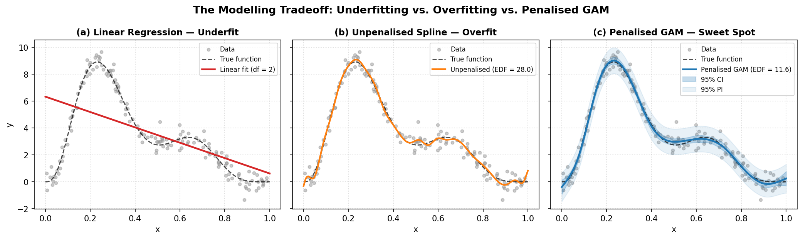
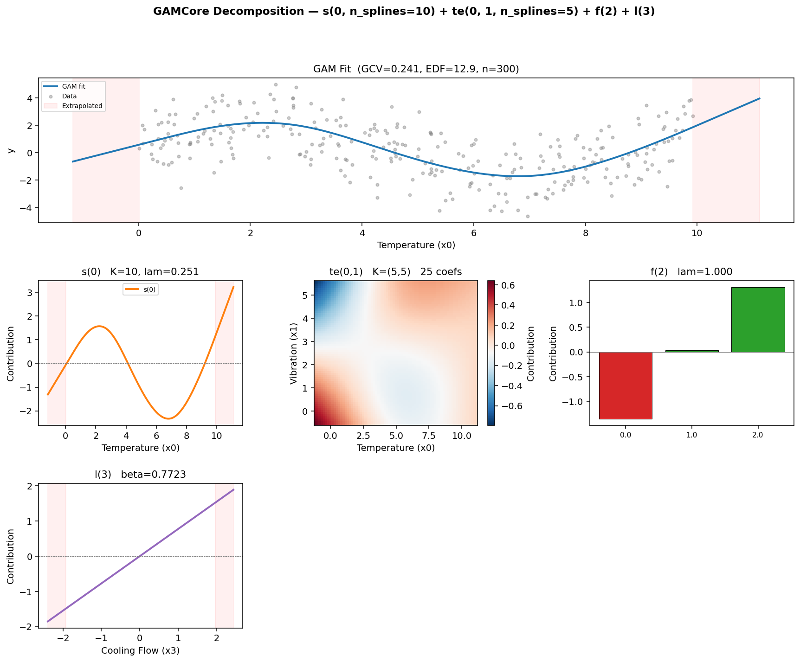

.. _part-shared:

Part I — Shared foundations
===========================

.. _section-why-gam:

Why GAMs?
---------

Classical linear regression fits a straight line (or hyperplane):

.. math::

   y_i = \beta_0 + \beta_1 x_{i1} + \beta_2 x_{i2} + \dots + \varepsilon_i.

The problem: the real world is rarely a straight line.  Temperature does not
degrade turbine blades linearly.  Dose-response curves saturate.  An
engine's sweet-spot RPM is a peak, not a slope.

**Generalised Additive Models** replace each linear term :math:`\beta_j
x_{ij}` with a *learned smooth function* :math:`f_j(x_{ij})`:

.. math::

   y_i = \beta_0 + f_1(x_{i1}) + f_2(x_{i2}) + \dots + \varepsilon_i.

Now the model can bend to match the data.  The word **additive** means the
contributions still *sum* together — there's no multiplicative or nested
structure, just a collection of understandable pieces you can inspect one at
a time.  The word **generalised** means we replaced "linear coefficient ×
predictor" with "learned function of predictor."

This is the central tradeoff of statistical modelling:

  **Simple models** (lines) don't capture reality.  **Complex models**
  (deep nets, random forests) capture it but you can't explain *how*.
  GAMs sit in the sweet spot: flexible enough to fit nonlinear patterns,
  interpretable enough that each term is a plot you can show to a colleague.

   **(a)** Ordinary linear regression underfits nonlinear curves. **(b)** An unpenalised
   high-capacity spline chases noise (:math:`\text{EDF} = 28`). **(c)** A penalised GAM
   recovers the underlying curve with calibrated 95% confidence and prediction intervals.

When you call ``model.plot_decomposition(x, y)``, what you see is the
**decomposition** of the prediction into independent pieces:

.. math::

   \hat y(\mathbf{x}) =
   \underset{\text{intercept}}{\beta_0}
   + \underset{\text{term 0}}{f_1(x_1)}
   + \underset{\text{term 1}}{f_2(x_2)}
   + \dots
   + \underset{\text{noise}}{\hat\varepsilon}.

Each subplot in the decomposition is one :math:`f_j` in isolation.  Because
the model is additive, the pieces are independent: changing :math:`x_1`
only affects :math:`f_1(x_1)`, not :math:`f_2(x_2)`.  This is the property
that makes GAMs **interpretable** where black-box models are not.

Both magli backends fit exactly this model.  Where they differ is *how*:
how each :math:`f_j` is represented, how the smoothness penalty is built,
how the smoothing parameter is chosen, and how uncertainty is reported.
Part II and Part III cover those differences; the shared philosophy is the
equation above.

.. _section-formula-decomposition:

Decomposition: how the model explains its predictions
-----------------------------------------------------

The defining feature of GAMs is that predictions decompose additively:

.. math::

   \hat y(\mathbf{x}_i) =
   \underbrace{\hat\beta_0}_{\text{intercept}}
   + \underbrace{\hat f_1(x_{i1})}_{\text{term 1}}
   + \underbrace{\hat f_2(x_{i2})}_{\text{term 2}}
   + \dots
   + \underbrace{\hat f_p(x_{ip})}_{\text{term p}}.

Each :math:`\hat f_j` is a *partial dependence function* — it shows how the
prediction changes when you vary :math:`x_j` while holding everything else
fixed (usually at the median).  This is the "all else equal" effect.

   Example ``GAMCore.plot_decomposition`` grid for ``s(0) + te(0, 1) + f(2) + l(3)``:
   overall fit at the top, followed by each term's isolated partial dependence.

**The plot_decomposition grid.**  When you call
``model.plot_decomposition(x, y)``, you see:

* **Top row — overall fit:** The model's prediction when sweeping the first
  predictor across its range, with all others at their medians.  Gray dots
  are the actual data.  This gives you a quick sanity check: does the curve
  pass through the cloud of points?

* **Per-term panels:** One subplot for each term in the formula:

  - ``s()`` panel: a line plot.  The curve shows how blade life changes with
    temperature (or RPM, or vibration).  A flat line means the term
    contributes nothing — the predictor doesn't matter.  A steep curve means
    the predictor is important.

  - ``te()`` panel: a 2-D heatmap (or projection line for 3+D).  Blue =
    below-average contribution, red = above-average.  Look for diagonal
    patterns — they indicate synergy.  A uniform color means no interaction.

  - ``f()`` panel: a bar chart.  Each bar is one category's baseline shift
    relative to the reference level.  Tall bars mean big differences between
    categories.

  - ``l()`` panel: a straight line :math:`\hat\beta_j x_j`.  The slope
    (:math:`\hat\beta_j` coefficient) is shown in the title, and the line
    passes through zero at :math:`x_j = 0`.

* **Red shaded regions:** Extrapolation — the model is predicting outside
  the range of the training data.  Treat these regions with caution; the
  linear extrapolation used there is a heuristic, not a guarantee.

* **Zero reference lines:** Each term's contribution is centred so that the
  sum of all contributions (plus intercept) equals the prediction.  The
  dashed horizontal line at zero shows where the term contributes nothing.

**How to read the decomposition as a story.**  Start from the leftmost
term and work right.  Each panel answers one question:

1. "What does temperature do to blade life, all else equal?"
2. "What does RPM do, all else equal?"
3. "Do temperature and vibration interact synergistically?"
4. "Does coating type A last longer than B?"
5. "Is cooling flow linearly protective?"

The answers are *independent* — they add up to the full prediction, but you
can understand each one without reference to the others.  This is the
superpower of additive models: complex predictions built from simple,
understandable pieces.

**Partial dependence vs. raw data.**  The partial dependence curves do NOT
show the raw data distribution; they show the *model's isolated view* of
each predictor.  A scatter of raw data against a single predictor mixes in
the effects of all other predictors, so it can look very different from the
partial dependence.  The partial dependence is the "clean" signal — the
model's best estimate of what that predictor alone contributes.

One subtlety to remember later: the two backends *centre* these term plots
differently.  The Wood backend enforces an explicit sum-to-zero constraint
on every smooth (so each panel is genuinely centred at zero), while the
Eilers-Marx backend lets the intercept absorb each term's overall level.  We'll
make this precise in :ref:`Part III<section-wood-identifiability>`.

