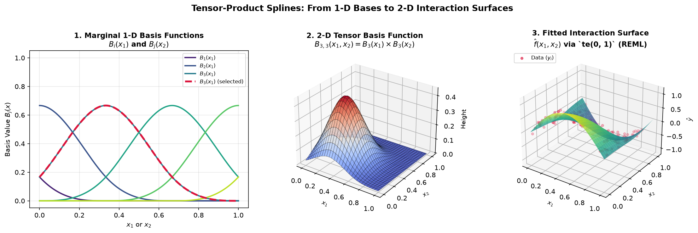

.. _part-shared:

Part I — Shared Foundations
===========================

.. _section-why-gam:

Why GAMs?
---------

Classical linear regression fits a straight line (or flat hyperplane):

.. math::

   y_i = \beta_0 + \beta_1 x_{i1} + \beta_2 x_{i2} + \dots + \varepsilon_i.

In practice, relationships in the real world are rarely straight lines. Temperature does not degrade turbine blades at a constant rate, dose-response curves level off as biological receptors saturate, and an engine's optimal efficiency occurs at a specific operating speed rather than rising indefinitely.

**Generalized Additive Models** address this limitation by replacing each fixed linear slope :math:`\beta_j x_{ij}` with a smooth, learned function :math:`f_j(x_{ij})`:

.. math::

   y_i = \beta_0 + f_1(x_{i1}) + f_2(x_{i2}) + \dots + \varepsilon_i.

This formulation allows the fitted curve to bend flexibly to match the contours of your data. The word **additive** means these non-linear effects still combine through simple addition. Because there are no nested trees or hidden layer multiplications, you can isolate and inspect the contribution of any single variable on its own. The word **generalized** reflects the upgrade from rigid linear coefficients to adaptive smooth functions.

This design addresses a central dilemma in data analysis. Simple linear regressions are straightforward to explain, but they frequently underfit non-linear patterns. Complex machine learning algorithms, such as gradient-boosted trees or deep neural networks, capture intricate curves but obscure the underlying mechanisms. Generalized Additive Models occupy a practical sweet spot, providing the flexibility needed to capture non-linear trends while ensuring that each predictor's effect can be plotted, understood, and communicated clearly.

.. figure:: ../_static/images/why_gam_sweet_spot.png
   :alt: Underfitting linear regression vs overfitting unpenalized spline vs penalized GAM
   :align: center
   :width: 100%

   How penalization tames complexity. Panel (a) illustrates ordinary linear regression failing to capture non-linear structure; panel (b) shows an unpenalized spline with excessive capacity chasing individual noise points (:math:`\text{EDF} = 28`); panel (c) shows a penalized GAM balancing flexibility against wiggliness, recovering the underlying mean trend with calibrated 95% confidence and prediction intervals.

When you call ``model.plot_decomposition(x, y)``, the model reveals how it constructed its prediction:

.. math::

   \hat y(\mathbf{x}) =
   \underset{\text{intercept}}{\beta_0}
   + \underset{\text{term 0}}{f_1(x_1)}
   + \underset{\text{term 1}}{f_2(x_2)}
   + \dots
   + \underset{\text{noise}}{\hat\varepsilon}.

Each individual curve in the decomposition plot represents one function :math:`f_j` in isolation. Because the model structure is strictly additive, changing the value of :math:`x_1` changes only :math:`f_1(x_1)` without distorting :math:`f_2(x_2)`. This independence makes GAMs uniquely interpretable.

Both backends in ``magli`` fit this exact additive structure. They differ in how they build their basis functions, how they construct smoothness penalties, how they optimize smoothing parameters, and how they report uncertainty. Those engineering choices are detailed in Part II and Part III, but the shared mathematical foundation is the equation above.

.. _section-formula-decomposition:

Decomposition — How the Model Explains Its Predictions
------------------------------------------------------

The defining feature of GAMs is that predictions decompose into independent additive pieces:

.. math::

   \hat y(\mathbf{x}_i) =
   \underbrace{\hat\beta_0}_{\text{intercept}}
   + \underbrace{\hat f_1(x_{i1})}_{\text{term 1}}
   + \underbrace{\hat f_2(x_{i2})}_{\text{term 2}}
   + \dots
   + \underbrace{\hat f_p(x_{ip})}_{\text{term p}}.

Each learned function :math:`\hat f_j` is a partial dependence curve. It shows how the expected outcome shifts as you sweep predictor :math:`x_j` across its range while holding all other variables constant at their median values.

.. figure:: ../_static/images/gamcore_decomposition.png
   :alt: GAMCore additive decomposition across s(), te(), f(), and l() terms
   :align: center
   :width: 100%

   An example of ``GAMCore.plot_decomposition`` for a model specified as ``s(0) + te(0, 1) + f(2) + l(3)``. The overall fit appears in the top panel, followed by isolated partial dependence plots for each smooth, interaction, categorical, and linear term.

When you generate a decomposition grid using ``model.plot_decomposition(x, y)``, the plot arranges several key visual components:

* The **overall fit panel** at the top displays the model's prediction as the primary predictor varies, holding all other features at their medians. The gray points show the raw observations, providing a quick sanity check on whether the curve tracks the data cloud.
* The **smooth term panels** (``s()``) display continuous non-linear curves. A steep slope highlights a strong effect, whereas a flat horizontal line indicates that the feature contributes little explanatory value.
* The **tensor interaction panels** (``te()``) present 2-D heatmaps showing how two variables interact. Diagonal contours signal synergy or antagonism, whereas uniform parallel bands indicate that an interaction is weak and an additive model would suffice.
* The **categorical panels** (``f()``) use bar charts to show baseline offsets for each level relative to the reference group.
* The **linear panels** (``l()``) show straight regression slopes :math:`\hat\beta_j x_j`, with the estimated coefficient displayed in the title.
* The **red shaded margins** mark extrapolation regions where the model predicts beyond the range of training observations. Because splines switch to linear extrapolation outside training boundaries, predictions in these regions should be interpreted with care.
* The **dashed horizontal zero lines** show where each term has a neutral contribution.

Reading a decomposition plot is like reading a story from left to right. Each panel answers a distinct physical question, such as how operating temperature influences component life, how shaft speed affects wear, or whether temperature and vibration combine synergistically. Because the model is additive, each answer stands on its own. While all components sum together to form the final prediction, you can evaluate the physical meaning of each curve independently without wrestling with hidden cross-talk.

It is worth noting that partial dependence curves show the model's isolated perspective on each variable rather than raw two-dimensional correlations. A raw scatter plot often mixes in confounding effects from other predictors, which can mask the true underlying relationship. The partial dependence curve extracts the isolated contribution, controlling for the remaining variables.

The two backends handle the vertical centering of these panels in different ways. The Wood backend projects every smooth onto a subspace that averages to zero across the training set, meaning each curve is genuinely centered around zero on the vertical axis. The Eilers-Marx backend instead lets the intercept absorb the baseline offset. We explore the mathematical mechanics behind this distinction in :ref:`Part III<section-wood-identifiability>` and :ref:`Part IV<section-backends-compared>`.

.. _section-core-intuitions:

Core Intuitions and Mental Models
---------------------------------

Before exploring the matrix algebra of the two backends, a few physical and geometric mental models make GAMs much easier to grasp.

The Elastic Spring Analogy for Penalties
^^^^^^^^^^^^^^^^^^^^^^^^^^^^^^^^^^^^^^^^

A standard polynomial or unpenalized spline treats every coefficient as a completely independent lever. If measurement noise pushes a single data point upward, an unpenalized model will happily twist and bend to chase it.

In a GAM, you can picture the spline coefficients :math:`\beta_1, \beta_2, \dots, \beta_K` as pegs spaced along the predictor axis, with adjacent pegs connected by elastic springs. A second-difference penalty (:math:`D_2`) penalizes sharp changes in slope. Whenever a peg is pulled out of line with its immediate neighbors, the spring resists with a tension proportional to the smoothing parameter :math:`\lambda`.

When :math:`\lambda = 0`, the springs go slack. Every peg moves freely, and the model overfits local noise. When :math:`\lambda \to \infty`, the springs become completely rigid, forcing all pegs into a straight line and collapsing the spline to its linear null space. In between, the springs allow the curve to bend where consistent observations agree on a genuine signal, while damping out the isolated wiggles caused by noise.

Demystifying Effective Degrees of Freedom (EDF)
^^^^^^^^^^^^^^^^^^^^^^^^^^^^^^^^^^^^^^^^^^^^^^^

In ordinary regression, degrees of freedom are whole integers: an unpenalized model with 10 basis functions consumes exactly 10 parameters. In a GAM, you will routinely see fractional outputs such as:

.. code-block:: text

   s(0):  EDF = 3.42,  k = 10

Because the smoothing penalty ties adjacent coefficients together, they can no longer move independently. Mathematically, the effective degrees of freedom (EDF) is defined as the trace of the influence matrix:

.. math::

   \text{EDF} = \operatorname{tr}\bigl( (X^\top X + S_\lambda)^{-1} X^\top X \bigr).

To understand this intuitively:

* An EDF of 1.0 means the penalty has pulled the curve entirely into a straight line with a single slope parameter.
* An EDF of 2.0 corresponds to a quadratic curve with a single bend.
* An EDF of 3.42 indicates that the curve has roughly the flexibility of a cubic polynomial, but with the local adaptability of a spline.
* An EDF close to the basis dimension (such as an EDF of 8.8 when :math:`k = 10`) warns you that the basis has saturated. When this happens, the true underlying function wanted more flexibility than the basis allowed, signaling that you should increase :math:`k`.

Confidence Intervals versus Prediction Intervals
^^^^^^^^^^^^^^^^^^^^^^^^^^^^^^^^^^^^^^^^^^^^^^^^^

``magli`` models provide two distinct uncertainty bands through ``model.confidence_intervals(x)`` and ``model.prediction_intervals(x)``, and keeping their purposes clear is essential:

* **Confidence intervals** reflect uncertainty about the true underlying mean curve :math:`f(x)`. If you gathered an infinite amount of data, this band would narrow to zero width because the estimate of the average trend becomes increasingly precise. It depends solely on parameter covariance, given by :math:`\operatorname{Var}(\hat{f}(x)) = \mathbf{b}(x)^\top V_{\boldsymbol{\beta}} \mathbf{b}(x)`.
* **Prediction intervals** answer where a new, individual observation will fall. Even if you knew the true curve with absolute certainty, individual measurements still scatter around that mean with standard deviation :math:`\sigma`. Prediction variance combines both sources of variation, giving :math:`\operatorname{Var}(y_{\text{new}} \mid x) = \operatorname{Var}(\hat{f}(x)) + \hat\sigma^2`. As a result, prediction intervals never collapse to zero width, regardless of your sample size.

Multidimensional Geometry and Tensor Products
^^^^^^^^^^^^^^^^^^^^^^^^^^^^^^^^^^^^^^^^^^^^^^^^^^^

When two variables interact, a purely additive model :math:`f_1(x_1) + f_2(x_2)` misses the synergy. For example, high operating temperature might be manageable at low vibration levels, but destructive when vibration is high.

Tensor-product smooths (``te()``) handle this by multiplying the marginal basis functions along each coordinate:

.. math::

   B_{i, j}(x_1, x_2) = B_i(x_1) \times B_j(x_2).

   Constructing a 2-D interaction surface with ``te()``. (1) Marginal 1-D basis functions along :math:`x_1` and :math:`x_2`. (2) A single 2-D tensor basis bump :math:`B_{3,3}(x_1, x_2)` localized at the intersection of both intervals. (3) The fitted 2-D surface :math:`\hat{f}(x_1, x_2)` capturing non-linear interactions across the data points.

Tensor products construct their penalty using a Kronecker sum of the marginal penalties:

.. math::

   S_{\text{total}} = \lambda_1 \, (S_1 \otimes I) + \lambda_2 \, (I \otimes S_2).

This structure allows the model to apply different degrees of smoothing along each axis. If the response varies sharply with :math:`x_1` but changes smoothly with :math:`x_2`, the optimizer estimates :math:`\lambda_1 \ne \lambda_2` automatically.

.. _section-diagnostic-guide:

A Practical Guide to Model Diagnostics
--------------------------------------

Once you fit a GAM, you should check whether the model is sound before relying on its predictions.

Reading `model.summary()`
^^^^^^^^^^^^^^^^^^^^^^^^^

The Wood backend summary table presents results in three clear blocks:

* The parametric table reports linear coefficients and the intercept, displaying standard errors, t-statistics, and p-values matching standard regression output.
* The smooth terms table lists the estimated EDF, reference degrees of freedom, and Wood's approximate F-statistic with its corresponding p-value. A small p-value confirms that the predictor has a statistically significant non-linear effect rather than flat noise.
* The model metrics summarize overall quality, reporting adjusted :math:`R^2`, deviance explained, and the REML or GCV model selection score.

Checking for Basis Saturation
^^^^^^^^^^^^^^^^^^^^^^^^^^^^^

The basis count :math:`k` defines the ceiling on how flexible a smooth term can be, while the penalty pulls that flexibility down to the optimal level.

If your estimated EDF is comfortably below :math:`k` (such as an EDF of 3.2 with :math:`k = 10`), the basis had plenty of capacity and the penalty found the right balance. However, if the EDF presses against the upper limit (such as an EDF of 9.2 with :math:`k = 10`), the term is saturated. The data wanted more flexibility than the basis could accommodate, and you should re-fit with a larger basis dimension such as :math:`k = 20` or :math:`k = 30`.

Boundary Flares and Data Sparsity
^^^^^^^^^^^^^^^^^^^^^^^^^^^^^^^^^

If you notice confidence intervals widening dramatically at the left or right boundaries of a decomposition plot, check the distribution of your predictor variable. Splines rely on overlapping basis functions, and when observations become sparse near the extremes, there is less evidence to anchor the curve. The widening bands honestly reflect that uncertainty, reminding you not to overinterpret trends where data is thin.

Four Essential Diagnostic Plots
^^^^^^^^^^^^^^^^^^^^^^^^^^^^^^^

Calling ``model.plot_diagnostics(x, y)`` generates four standard diagnostic views:

* The **Observed versus Fitted** plot shows how closely predictions track actual outcomes. In a well-fitting model, points cluster tightly along the diagonal identity line.
* The **Residuals versus Fitted** plot checks for unmodeled patterns. Points should scatter evenly around the horizontal zero line without curving or funneling. Any curvature suggests a missing non-linear term or an unmodeled interaction.
* The **Residual Histogram** confirms that error distributions are approximately symmetric and centered at zero.
* The **Normal Q-Q Plot** compares residual quantiles against standard Gaussian quantiles. Points falling along the diagonal reference line indicate normally distributed errors, while sharp departures in the tails flag heavy-tailed noise or outliers that may benefit from observation weights (``weights=...``).
