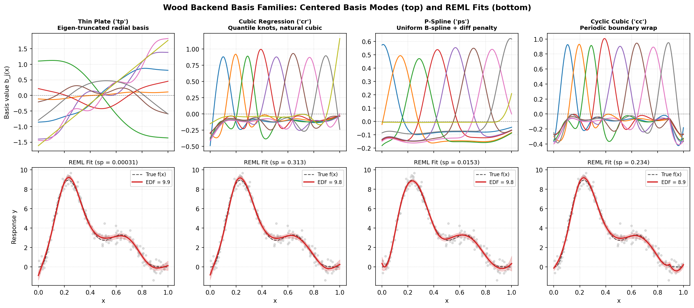
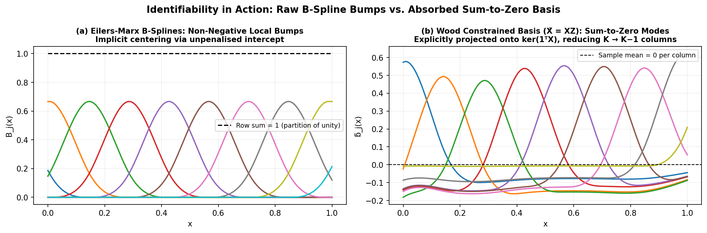

.. _part-wood:

Part III — The Wood backend
===========================

.. _section-wood-design:

How the Wood backend thinks
---------------------------

The Wood backend (``backend='wood'``) is a pure Python implementation of Simon
Wood's GAM framework (Wood 2006, 2011, 2017).  Where the Eilers-Marx backend bets
on one basis and a grid search, Wood bets on **richness and automatic
inference**:

1. **A zoo of bases.**  Nine basis codes (``'tp'``, ``'ts'``,
   ``'cr'``, ``'cs'``, ``'cc'``, ``'ps'``, ``'cp'``, ``'bs'``, ``'re'``)
   with different knot placements, different penalties, and different
   shrinkage behaviour.  Each solves the smoothness problem a slightly
   different way.
2. **One smoothing parameter per penalty, estimated.**  Instead of
   sweeping a grid, the backend treats :math:`\lambda` as a free
   parameter and *optimises* a model-selection criterion — Restricted
   Maximum Likelihood (REML) by default, GCV as an option — in
   log-:math:`\lambda` space with standard optimisers.
3. **Explicit identifiability.**  Every smooth is centred by absorbing a
   sum-to-zero constraint into the basis itself, and every penalty is
   rescaled to a common scale (``S.scale``), so the :math:`\lambda`
   values are comparable across terms.
4. **Full inferential machinery.**  Bayesian and frequentist covariances,
   per-term approximate F-tests with p-values (Wood 2013), AIC/BIC,
   deviance explained.

The pipeline is:

.. math::

   \text{formula}
   \;\to\;
   \underbrace{\text{basis + penalty per term}}_{\S 1}
   \;\to\;
   \underbrace{\text{rescale, centre}}_{\S 2}
   \;\to\;
   \underbrace{\text{optimise } \lambda \text{ by REML/GCV}}_{\S 3}
   \;\to\;
   \underbrace{\text{inference}}_{\S 4}.

Sections 1–4 below follow that order.

.. _section-wood-bases:

The basis zoo
-------------

All of the Wood bases share one objective: represent a smooth
:math:`f(x)` as a linear combination of basis functions with an attached
**wiggliness penalty** :math:`\boldsymbol{\beta}^\top S
\boldsymbol{\beta}`.  Three of the families (``tp``, ``cr``, ``cc``)
penalise the exact curvature integral :math:`\int f''(x)^2\,dx`; the
P-spline and B-spline families penalise a discrete difference approximation
of it; the random effect family penalises the coefficients directly.  Here's
the map:

.. list-table::
   :header-rows: 1

   * - Code
     - Family
     - Basis functions
     - Penalises
     - Null space
   * - ``tp``
     - Thin plate regression spline
     - :math:`k` leading eigenfunctions of the curvature kernel
     - :math:`\int f''^2 dx`
     - constants + linear (dim 2)
   * - ``ts``
     - Thin plate, shrinkage
     - same as ``tp``
     - curvature + small charge on the null space
     - none (can shrink to zero)
   * - ``cr``
     - Cubic regression spline
     - natural cubics, knots at sample quantiles
     - :math:`\int f''^2 dx`
     - linear functions (dim 2)
   * - ``cs``
     - Cubic, shrinkage
     - same as ``cr``
     - curvature + small charge on the null space
     - none (can shrink to zero)
   * - ``cc``
     - Cyclic cubic
     - periodic natural cubics
     - :math:`\int f''^2 dx` on the circle
     - constants (dim 1)
   * - ``ps``
     - P-spline (Eilers & Marx)
     - cubic B-splines, equally spaced knots
     - :math:`m`-th order differences of coefficients
     - polynomials of degree :math:`< m`
   * - ``cp``
     - Cyclic P-spline
     - cubic B-splines on wrapped knots
     - wrapped :math:`m`-th order differences of coefficients
     - constants (dim 1)
   * - ``bs``
     - B-spline
     - degree-:math:`m_{\text{basis}}` B-splines (default cubic), equally spaced knots
     - :math:`m_{\text{pen}}`-th order differences of coefficients
     - polynomials of degree :math:`< m_{\text{pen}}`
   * - ``re``
     - Random effect
     - one column per factor level
     - :math:`\sum \beta_j^2` (ridge)
     - none (all levels shrunken)

   Four representative families from the Wood basis zoo (:math:`k = 10`).
   *Top row*: centred basis modes after absorbing the sum-to-zero constraint
   (notice how ``tp`` orders modes from global low-frequency to local
   high-frequency, whereas ``cr`` and ``ps`` localise bumps around knots).
   *Bottom row*: REML-fitted smooths and 95% Bayesian credible bands on the
   same noisy signal, with ``cc`` enforcing periodic wrap-around at the
   boundaries.

The table's "null space" column matters more than it looks: those are the
function shapes that cost *nothing* to include.  A penalty with a null
space leaves the corresponding pattern unpenalised and lets the intercept
(or the model's other terms) absorb it.

.. _section-wood-tp:

Thin plate regression splines (``tp``, ``ts``)
~~~~~~~~~~~~~~~~~~~~~~~~~~~~~~~~~~~~~~~~~~~~~~

The default in the Wood backend, and the most mathematically interesting family.  It
starts from a *continuous* problem, not a knot placement.

**The continuous problem.**  Among all functions with two derivatives,
find the :math:`f` minimising

.. math::

   \sum_{i=1}^n \bigl( y_i - f(x_i) \bigr)^2
   + \lambda \int f''(x)^2 \, dx.

The first term is ordinary least squares; the second charges the total
squared curvature.  It turns out (the *representer theorem* for splines)
that the minimiser has the form

.. math::

   f(x) = \sum_{i=1}^n \delta_i \, \eta(|x - x_i|) + \alpha_0 + \alpha_1 x,
   \qquad
   \eta(r) = \frac{|r|^3}{12},

subject to :math:`\sum_i \delta_i = \sum_i \delta_i x_i = 0` (the
:math:`T^\top\delta = 0` constraint).  The :math:`n` "radial" basis
functions sit one on each data point; the two polynomial terms form the
**null space** — they have zero curvature, so the penalty never touches
them.

**Why** :math:`\boldsymbol{\eta(r) = |r|^3/12}` **?**  It is the Green's
function of the fourth-derivative operator:

.. math::

   \frac{d^4}{dr^4}\left(\frac{|r|^3}{12}\right) = \delta(r),

where :math:`\delta` is the Dirac delta.  Consequence: for any function of
the form above, the curvature integral collapses to a quadratic form in
the coefficients,

.. math::

   \int f''(x)^2 \, dx \;=\; \boldsymbol{\delta}^\top E \boldsymbol{\delta},
   \qquad
   E_{ij} = \eta(|x_i - x_j|).

A one-line sanity check: for :math:`r > 0`,
:math:`\eta'''(r) = 1/2` (and :math:`-1/2` for :math:`r < 0`), so the
third derivative jumps by exactly 1 at the origin — which is what makes
the fourth derivative a unit Dirac spike.  The "thin plate" name comes
from the :math:`d=2` generalisation, where the penalty is the bending
energy of a physical plate.

**Conditional positive definiteness.**  The matrix :math:`E` has both
positive and negative eigenvalues, but it is *positive definite on the
subspace orthogonal to the null space* (:math:`T^\top\delta = 0`).
Solving the continuous problem exactly gives :math:`f` with one parameter
per data point (an :math:`O(n)` model) — beautiful, but too expensive and
over-flexible for practical use.

**The low-rank approximation.**  Wood's trick (and magli's) is to keep
only the :math:`k` most important radial directions.  Eigen-decompose

.. math::

   E = U \operatorname{diag}(v) U^\top,

sort eigenpairs by :math:`|v_j|`, and truncate to the top :math:`k`:

.. math::

   E_k = U_k \operatorname{diag}(v_k) U_k^\top.

(The code uses ARPACK's ``eigsh`` for speed when there are many unique
points, and falls back to a full ``eigh`` otherwise.)  The retained
eigenfunctions are the smoothest, largest-scale modes — exactly the
structure you want in a smooth — while the discarded high-frequency modes
are the ones a penalty would crush anyway.

**Absorbing the constraint.**  We still need the retained directions to
be orthogonal to the null space, i.e. :math:`T^\top U_k \delta = 0`.
Compute a Householder rotation :math:`Q` such that

.. math::

   T^\top U_k \, Q = \bigl[\,0_{M \times (k-M)} \;\; R\,\bigr],
   \qquad M = 2.

Then the first :math:`k-M` columns of :math:`U_k Q` span exactly the
retained modes that are orthogonal to constants and linear terms.  The
basis and penalty become

.. math::

   X = \Bigl[\, U_k \operatorname{diag}(v_k) Q_{[:, :k-M]}
   \;\;\; T \,\Bigr],
   \qquad
   S = Q^\top \operatorname{diag}(v_k) Q
       \;\text{with rows/cols}\; k-M \dots k-1 \;\text{zeroed}.

The last :math:`M` columns of :math:`X` are :math:`[1, x-\bar x]`
(the null space, unpenalised); the first :math:`k-M` columns are the
penalised modes, each charged by its eigenvalue :math:`v_j`.

**Column rescaling.**  Finally each column of :math:`X` is scaled to unit
root-mean-square and :math:`S` is divided by the corresponding row/column
products (:math:`S_{ij} \leftarrow S_{ij} / (w_i w_j)`).  This keeps the
numerical scale of :math:`X` and :math:`S` comparable no matter what
units :math:`x` is measured in.

**Prediction at new points** follows the same construction without
re-truncating: :math:`X_{\text{new}} = \bigl[ E_{\text{new}} U_k Q_{[:, :k-M]},\;\;
[1, x_{\text{new}} - \bar x] \bigr]` (then divided by the same column
scales), where :math:`(E_{\text{new}})_{ij} = \eta(|x_i^{\text{new}} -
x_j^{\text{train}}|)`.

**Shrinkage (``ts``).**  The penalty :math:`S` above has a two-dimensional
null space (the :math:`T` part).  That means :math:`\lambda` can shrink
the wiggly part all it wants, but the linear trend in :math:`f` is never
penalised — a ``tp`` smooth can never be removed from the model.  The
``ts`` variant changes this by eigen-decomposing :math:`S` and giving the
null-space eigenvalues a small positive value:

.. math::

   \text{ev}_{0}, \text{ev}_{1} \leftarrow \text{ev}_2 \times 0.1,

which charges the linear trend just enough that a strong :math:`\lambda`
can shrink the whole smooth to zero.  (This is also how model selection
can effectively drop a term.)

.. _section-wood-cr:

Cubic regression splines (``cr``, ``cs``)
~~~~~~~~~~~~~~~~~~~~~~~~~~~~~~~~~~~~~~~~~

If thin plate splines are the elegant continuous solution, cubic
regression splines are the workhorse discrete one.  The idea: place
:math:`k` knots at the sample **quantiles** of the unique :math:`x`
values, demand that :math:`f` be a cubic polynomial between knots, twice
continuously differentiable at each knot, and *linear outside the range of
the knots* (the "natural" boundary condition: :math:`f'' = 0` beyond the
first and last knot).

**The value–curvature parametrisation.**  A natural cubic spline is fully
determined by its values at the knots together with the natural boundary
condition.  Within an interval :math:`[x_j, x_{j+1}]` of width
:math:`h_j`, the spline interpolates between knot values
:math:`f_j, f_{j+1}` and second derivatives :math:`\gamma_j,
\gamma_{j+1}`:

.. math::

   f(x) = \frac{(x_{j+1}-x)^3 - h_j^2(x_{j+1}-x)}{6h_j}\,\gamma_j
        + \frac{(x-x_j)^3 - h_j^2(x-x_j)}{6h_j}\,\gamma_{j+1}
        + \frac{x_{j+1}-x}{h_j}\, f_j
        + \frac{x-x_j}{h_j}\, f_{j+1}.

(This is the formula the ``_eval_cr_basis`` code implements, with
:math:`\gamma = F\boldsymbol{\beta}` and the linear hat functions added
on top.)

**Two linear systems connect everything.**  For :math:`n_k` knots:

* The second derivatives at the knots are a linear function of the knot
  values, :math:`\boldsymbol{\gamma} = B^{-1} D \,\mathbf{f}`, where
  :math:`D` is the :math:`(n_k-2) \times n_k` divided-second-difference
  matrix

  .. math::

     D = \begin{pmatrix}
     \frac{1}{h_1} & -(\frac{1}{h_1}+\frac{1}{h_2}) & \frac{1}{h_2} & & \\
     & \frac{1}{h_2} & -(\frac{1}{h_2}+\frac{1}{h_3}) & \frac{1}{h_3} & \\
     & & \ddots & \ddots & \ddots
     \end{pmatrix},

  and :math:`B` is the symmetric tridiagonal matrix with diagonal
  :math:`(h_j + h_{j+1})/3` and off-diagonal :math:`h_{j+1}/6`.

* The curvature integral then factorises as

  .. math::

     \int f''(x)^2\,dx \;=\; \boldsymbol{\gamma}^\top B \boldsymbol{\gamma}
     \;=\; \mathbf{f}^\top D^\top B^{-1} D \,\mathbf{f}
     \;\Rightarrow\;
     S = D^\top B^{-1} D.

  Deriving it is a two-line calculus exercise: between knots :math:`f''`
  is a straight line, so its integral is exactly the quadratic form with
  the tridiagonal :math:`B`.

:math:`S` has rank :math:`k-2`: its null space is the two-dimensional
space of linear functions (straight lines have no curvature), which again
remain unpenalised.  Extrapolation beyond the boundary knots is linear by
construction — the natural boundary condition *is* linear extrapolation,
so ``cr`` behaves predictably outside the data range.

**Shrinkage (``cs``)** is the discrete twin of ``ts``: eigen-decompose
:math:`S`, and charge the two null-space eigenvalues at 0.1× and 0.01× the
smallest positive one:

.. math::

   \text{ev}_1 \leftarrow \text{ev}_2 \times 0.1, \qquad
   \text{ev}_0 \leftarrow \text{ev}_1 \times 0.1.

The linear trend is now weakly penalised, so a strong :math:`\lambda` can
shrink the whole term toward zero.

.. _section-wood-cc:

Cyclic cubic regression splines (``cc``)
~~~~~~~~~~~~~~~~~~~~~~~~~~~~~~~~~~~~~~~~

For quantities on a circle — time-of-day, wind direction, phase angles —
the boundary values should agree: :math:`f(x_0) = f(x_1)` and matching
derivatives.  The cyclic cubic spline (Lancaster & Salkauskas 1986) takes
the ``cr`` construction and *wraps* it: knots are placed evenly through
the sorted unique :math:`x` values, and the :math:`B` and :math:`D`
matrices become **circulant** — the last interval connects back to the
first, as in the code's ``build_cc_basis``:

.. math::

   B_{0,0} = \frac{h_{n-1} + h_0}{3}, \quad B_{0,1} = \frac{h_0}{6},
   \quad B_{0,n-1} = \frac{h_{n-1}}{6},

with the mirror entries on the last row, and similarly for :math:`D`.
The penalty is the same form, :math:`S = D^\top B^{-1} D`, now of rank
:math:`k-2` with a one-dimensional null space — constants only, since a
periodic function that is "straight" is exactly constant.  Evaluating the
basis wraps the covariate cyclically onto :math:`[x_0, x_1]` first.

.. _section-wood-ps:

P-splines and B-splines (``ps``, ``cp``, ``bs``)
~~~~~~~~~~~~~~~~~~~~~~~~~~~~~~~~~~~~~~~~~~~~~~~~

Eilers & Marx (1996) cut the problem even further: forget exact curvature
integrals; place a **uniformly spaced** grid of knots (extended 0.1%
beyond the data range, plus :math:`m_{\text{basis}}+1` knots past each
end so all :math:`k` basis functions are well defined), build cubic
B-splines on it, and penalise the *:math:`m`-th order differences* of
adjacent coefficients:

.. math::

   S = D^\top D, \qquad
   D = \underbrace{\Delta^m}_{\text{repeated differencing}},
   \qquad (k-m) \times k.

The default is :math:`m = 2`: second differences, the discrete
counterpart of curvature.  The penalty's null space is the space of
polynomials of degree :math:`< m` — for :math:`m=2`, linear trends are
free.  P-splines trade a little elegance for speed and simplicity (the
penalty needs no matrix inverse, unlike :math:`B^{-1}` in ``cr``), and
the equal knot spacing makes the basis numerically well behaved.

* ``'ps'`` defaults to ``m=(2, 2)`` (in Wood's convention :math:`m_{\text{basis}} = 2` denotes cubic B-splines and :math:`m_{\text{pen}} = 2` denotes second differences).
* ``'bs'`` uses standard B-spline degree indexing (default ``m=(3, 2)`` for cubic B-splines with second-difference penalty) and shares the same underlying builder.
* For cyclic P-splines (``'cp'``), both the B-spline basis (via cyclic knot wrapping) and the :math:`m`-th order difference penalty wrap around the boundaries, leaving only constants in the one-dimensional null space.

.. _section-wood-re:

Random-effect smooths (``re``)
~~~~~~~~~~~~~~~~~~~~~~~~~~~~~~

For a categorical predictor with many levels, ``re`` builds one column per
level (an identity/one-hot design matrix) and penalises the coefficients
with :math:`S = I` — pure ridge shrinkage:

.. math::

   \boldsymbol{\beta}^\top S \boldsymbol{\beta}
   = \sum_j \beta_j^2.

In the Bayesian view (see the REML section) this is exactly a
random-effects model: level effects drawn from :math:`N(0, \sigma^2 /
\lambda)`, and :math:`\lambda` estimated from the data is the
inverse-variance of the random effect.  Larger :math:`\lambda` shrinks
all level effects toward zero, pooling the levels together.

.. _section-wood-identifiability:

Identifiability: rescaling and the sum-to-zero constraint
---------------------------------------------------------

A GAM with an intercept is over-parametrised: adding a constant to a
smooth :math:`f_j` and subtracting it from the intercept leaves every
prediction unchanged.  Fitting "works" regardless, but the decomposition
becomes arbitrary — you cannot say whether the average blade life came
from the intercept or from the temperature term.  The Wood backend resolves this with
two standard moves, both applied to *every* smooth term before fitting.

**Move 1 — ``S.scale``: rescale each penalty.**  A penalty's raw size
depends on its basis: a basis of large-magnitude functions produces a
large :math:`S`.  To make the smoothing parameter mean "amount of
smoothing" rather than "basis scale × amount of smoothing", each penalty
is normalised by

.. math::

   \text{S.scale}_i
   = \frac{\|S_i\|_{\text{O}}}{\|X\|_{\text{I}}^2},
   \qquad
   S_i \leftarrow \frac{S_i}{\text{S.scale}_i},

where :math:`\|\cdot\|_{\text{O}}` is the maximum column sum (the
operator norm of a symmetric matrix) and :math:`\|\cdot\|_{\text{I}}` is
the maximum row sum of :math:`X`, squared.  The scale is saved, so
reported :math:`\lambda` values are on this normalised scale — comparable
across terms and across basis families.

**Move 2 — ``absorb.cons``: absorb the sum-to-zero constraint.**  The
constraint is that each smooth's fitted values average to zero:

.. math::

   C \boldsymbol{\beta} = 0, \qquad C = \mathbf{1}^\top X
   \;\; \text{(the row of column sums)}.

Rather than solving a constrained problem, the constraint is *absorbed
into the basis*: compute the full QR of :math:`C^\top`
(:math:`k \times 1`), take :math:`Z = Q_{[:, 1:]}`
— an orthonormal basis of :math:`\ker C` — and project:

.. math::

   \tilde X = X Z, \qquad \tilde S_i = Z^\top S_i Z.

Now :math:`\mathbf{1}^\top \tilde X = 0` identically: the smooth is
centred *by construction*, in every fit, at every :math:`\lambda`, and in
every prediction.  The intercept owns the level; each smooth owns only
its shape.  This is why Wood decomposition panels are genuinely centred at
zero, while the Eilers-Marx panels rely on the intercept to absorb levels.

   *Left*: Eilers-Marx B-spline basis columns (:math:`K = 8`) are non-negative
   and satisfy the partition of unity :math:`\sum_j B_j(x) = 1`, so any
   constant shift can be traded with the intercept.  *Right*: Wood's
   ``absorb_constraints`` projects the basis onto the :math:`(K-1)`-dimensional
   subspace where every column has zero sample mean (:math:`\mathbf{1}^\top \tilde{X} = \mathbf{0}`),
   guaranteeing a unique, zero-centred partial effect.

For tensor-product terms the same pipeline applies after assembling the
Kronecker-sum penalties; each marginal penalty is first normalised by its
largest eigenvalue (so the dimensions contribute to the penalty on equal
footing), then the usual ``S.scale`` + ``absorb.cons`` pass runs on the
full tensor basis.

.. _section-wood-reml:

Smoothing parameter selection: REML and GCV.Cp
----------------------------------------------

Both backends minimise the same penalised objective,

.. math::

   \| \mathbf{y} - X\boldsymbol{\beta} \|^2
   + \sum_i \lambda_i \boldsymbol{\beta}^\top S_i \boldsymbol{\beta}
   = \| \mathbf{y} - X\boldsymbol{\beta} \|^2
   + \boldsymbol{\beta}^\top S_{\boldsymbol{\lambda}} \boldsymbol{\beta},

but they choose :math:`\boldsymbol{\lambda}` differently.  The Eilers-Marx
backend sweeps a grid and scores each point with GCV.  The Wood backend
treats :math:`\boldsymbol{\lambda}` as continuous parameters of a
model-selection criterion and *optimises*.  For a fixed
:math:`\boldsymbol{\lambda}`, the fit is obtained by QR of :math:`X` and
a Cholesky solve of

.. math::

   H = R^\top R + S_{\boldsymbol{\lambda}} = L L^\top,
   \qquad
   \hat{\boldsymbol{\beta}} = H^{-1} X^\top \mathbf{y}.

(With the tiny ridge on :math:`H`'s diagonal guarding the
:math:`\lambda = 0` edge case.)

**GCV.Cp.**  The same criterion as the Eilers-Marx backend, computed from the
Cholesky factor instead of an SVD.  The EDF is

.. math::

   \text{EDF} = \operatorname{tr}(H^{-1} R^\top R)
   = \| L^{-1} R^\top \|_F^2,

(a trace identity: :math:`\operatorname{tr}(ABA^\top) = \|AB^{1/2}\|_F^2`
with :math:`A = R`, :math:`B = H^{-1} = L^{-\top}L^{-1}`), and the score is

.. math::

   V_g(\boldsymbol{\lambda}) = \frac{n \cdot \text{RSS}}{(n - \gamma \cdot \text{EDF})^2},
   \qquad
   \hat\sigma^2 = \frac{\text{RSS}}{n - \text{EDF}}.

Here the default :math:`\gamma = 1` (``GCV.Cp``), versus 1.4 in
the Eilers-Marx backend — a small but real difference between the two engines'
model-selection tastes.

**REML (the default).**  Give the coefficients a Gaussian prior whose
precision *is* the penalty,

.. math::

   \mathbf{y} = X\boldsymbol{\beta} + \boldsymbol{\varepsilon}, \quad
   \boldsymbol{\varepsilon} \sim N(0, \sigma^2 I), \qquad
   \boldsymbol{\beta} \sim N\bigl(0, \,\sigma^2 S_{\boldsymbol{\lambda}}^{-}\bigr),

where :math:`S_{\boldsymbol{\lambda}}^{-}` denotes the (generalised)
inverse — an *improper* prior that treats the penalty's null space as
infinite variance.  Integrating :math:`\boldsymbol{\beta}` out gives the
marginal (restricted) likelihood for :math:`\boldsymbol{\lambda}` and
:math:`\sigma^2`.  Profiling out :math:`\sigma^2` at

.. math::

   \hat\sigma^2 = \frac{D_p}{n - M_p}, \qquad
   D_p = \underbrace{\|\mathbf{y} - X\hat{\boldsymbol{\beta}}\|^2}_{\text{RSS}}
       + \underbrace{\hat{\boldsymbol{\beta}}^\top S_{\boldsymbol{\lambda}} \hat{\boldsymbol{\beta}}}_{\text{penalty cost}},

where :math:`M_p` is the dimension of the parametric part of the model
(the intercept, :math:`M_p = 1`), the criterion to minimise is

.. math::

   \ell_r(\boldsymbol{\lambda}) \;=\;
   \frac{D_p}{2\hat\sigma^2}
   + \frac{n - M_p}{2} \log(2\pi\hat\sigma^2)
   + \frac12 \log |H|
   - \frac12 \log |S_{\boldsymbol{\lambda}}|_+ .

Reading it term by term:

* :math:`D_p / 2\hat\sigma^2`: how well the penalised fit explains the
  data, measured against the estimated noise.  The first two terms
  together are :math:`(n-M_p)(1 + \log 2\pi\hat\sigma^2)/2` after
  substituting :math:`\hat\sigma^2` — a pure function of the penalised
  deviance.
* :math:`\frac12 \log|H|`: a complexity tax.  The more the penalty is
  weakened, the larger :math:`H`'s determinant, the worse the score.
  This term is what prevents :math:`\lambda \to 0`.
* :math:`-\frac12 \log|S_{\boldsymbol{\lambda}}|_+`: a normalisation
  correction for the prior.  :math:`|S|_+` is the product of the
  *positive* eigenvalues only (the penalty is singular by design — its
  null space would otherwise contribute :math:`\log 0 = -\infty`).

Why the ":math:`_+`" matters can be seen by taking :math:`S_\lambda =
\lambda S` with :math:`\operatorname{rank}(S) = r`:
:math:`\log|S_\lambda|_+ = r\log\lambda + \log|S|_+`, which scales
correctly with the rank.  When each penalty acts on its own disjoint block of
coefficients, ``_precompute_penalty_structure`` precomputes the rank and
positive eigenvalues once:

.. math::

   \log |S_{\boldsymbol{\lambda}}|_+ = \sum_i
   \Bigl[ \operatorname{rank}(S_i) \log \lambda_i
   + \sum_j \log \text{ev}^+_j(S_i) \Bigr],

When multiple penalties overlap on the same coefficient block (such as the
marginal penalties of a ``te()`` tensor smooth), the implementation projects
each component onto the positive eigenspace of :math:`\sum_i S_i` once, and
evaluates :math:`\log |S_{\boldsymbol{\lambda}}|_+` via a pre-balanced
Cholesky factorisation of the reduced positive-definite matrix (falling back
to ``eigvalsh`` only if needed).

:math:`\log|H|` needs no eigendecomposition: from the Cholesky factor,
:math:`\log|H| = 2\sum_i \log L_{ii}`.

**Why REML and not maximum likelihood?**  In the mixed-model view,
estimating :math:`\boldsymbol{\beta}` costs degrees of freedom; plain ML
ignores this and biases :math:`\sigma^2` (and thus :math:`\lambda`)
downward — it under-smoothes.  The restricted likelihood corrects for
exactly this loss, which is why the criterion uses :math:`n - M_p`
instead of :math:`n`.  REML also has better-behaved optima than GCV,
which is notorious for flat minima and occasional near-zero
:math:`\lambda` solutions.

**Optimising in log space.**  :math:`\lambda` must be positive, so the
backend optimises :math:`\rho = \log\lambda` (unconstrained, with
:math:`\lambda = e^\rho`) over the range :math:`\rho \in [-15, 15]` —
i.e. :math:`\lambda` between roughly :math:`3\times10^{-7}` and
:math:`3\times10^{6}`.  One free :math:`\lambda`: Brent's method
(``minimize_scalar``, bounded) on the 1-D criterion.  Several free
:math:`\lambda` (e.g. multi-term models or one per tensor dimension):
L-BFGS-B with exact **analytic gradients** (``jac=True``) starting from
:math:`\rho = 0` (:math:`\lambda = 1`).  Because the envelope theorem cancels
the implicit :math:`\partial\hat{\boldsymbol{\beta}}/\partial\rho_j` terms in
:math:`\partial D_p / \partial\rho_j = \lambda_j \hat{\boldsymbol{\beta}}^\top S_j \hat{\boldsymbol{\beta}}`,
both the REML and GCV gradients fall out of the existing Cholesky factor
:math:`L` in a single pass without finite-difference evaluations.  Individual
:math:`\lambda` values can be pinned with ``sp=`` if you want some terms
fixed and others estimated, and ``model.gridsearch()`` is also available on
Wood models if you wish to search over candidate basis dimensions :math:`k`
while REML/GCV optimises :math:`\boldsymbol{\lambda}` continuously at each
candidate :math:`k`.

The REML score itself is reported in ``statistics_`` along with the
estimated :math:`\lambda` values, so you can compare models on the
restricted likelihood.

.. _section-wood-inference:

Inference: two covariances, one F-test
--------------------------------------

With :math:`\boldsymbol{\lambda}` estimated, the backend computes a full
inferential kit.  Two covariance matrices appear:

.. math::

   V_p = H^{-1}\hat\sigma^2, \qquad
   V_e = H^{-1} X^\top X H^{-1} \hat\sigma^2
       = H^{-1} R^\top R H^{-1} \hat\sigma^2.

* :math:`V_p` is the **Bayesian posterior covariance** — the posterior
  of :math:`\boldsymbol{\beta}` under the prior that generated REML, with
  :math:`\lambda` treated as known.  It is what the Wood backend reports in
  ``summary()`` tables and uses for confidence bands; standard errors are
  :math:`\operatorname{SE}_j = \sqrt{(V_p)_{jj}}`.
* :math:`V_e` is the **frequentist (sandwich) covariance** — the
  sampling covariance of :math:`\hat{\boldsymbol{\beta}}` treating the
  penalty as part of the estimator, again with :math:`\lambda` fixed.
  It ignores the uncertainty in :math:`\lambda` itself (a standard
  simplification in Wood's formulation, though the literature notes it makes
  intervals slightly optimistic).

Interval widths for a new point :math:`\mathbf{x}^*` come from
:math:`\mathbf{x}^{*\top} V_p \,\mathbf{x}^*`, with
:math:`\hat\sigma^2` added for *prediction* intervals; the implementation
uses t quantiles with :math:`n - \text{EDF}` degrees of freedom.

**Per-coefficient and per-term EDF.**  From the influence matrix

.. math::

   F = H^{-1} R^\top R, \qquad
   \text{EDF} = \operatorname{tr}(F),
   \qquad
   \text{EDF}_j = F_{jj}.

Term-level EDF is the sum of :math:`F_{jj}` over that term's coefficient
block.  A term with EDF near 1 is essentially linear; a term whose EDF
barely exceeds 1 despite a large :math:`k` is doing very little.

**Wood's approximate F-tests.**  For each term, testing
:math:`H_0:\; f_j = 0` (in basis terms, :math:`\boldsymbol{\beta}_j =
0`), the Wood backend uses the test statistic (Wood 2013)

.. math::

   F_j = \frac{\hat{\boldsymbol{\beta}}_j^\top
              V_{p,j}^{-1} \hat{\boldsymbol{\beta}}_j}
              {\text{EDF}_j}
   \;\sim\; F(\text{EDF}_j,\; n - \text{EDF}_{\text{total}})
   \;\; \text{under } H_0,

with the p-value from the right tail of the F distribution.  The
justification is a moment-matching argument: under the null the
quadratic form has mean :math:`\text{EDF}_j` and variance
:math:`2\,\text{EDF}_j`, matching an :math:`F`-like distribution to
second order.  It is an *approximation* — exact for
:math:`\lambda = 0` (where it reduces to the classical F-test) and
well-calibrated for EDF comfortably above 1, but p-values for terms with
EDF barely above 1 should be read with suspicion (a known caveat in Wood 2013).

**Model-level summaries.**  The backend also reports:

.. math::

   \text{deviance explained} = 1 - \frac{\text{RSS}}{\sum_i (y_i-\bar y)^2},
   \qquad
   R^2_{\text{adj}} = 1 - \frac{\text{RSS}/(n-\text{EDF})}
                                {\text{TSS}/(n-1)},

the Gaussian log-likelihood :math:`\ell = -\tfrac{n}{2}\log(2\pi\hat\sigma^2)
- \tfrac{\text{RSS}}{2\hat\sigma^2}`, and the information criteria
:math:`\text{AIC} = -2\ell + 2(\text{EDF}+1)`, :math:`\text{BIC} = -2\ell
+ \log(n)(\text{EDF}+1)` — the :math:`+1` counting the estimated
:math:`\sigma^2`.  These make the Wood backend the choice when you need
p-values, AIC-based model comparison, or output that matches an R
``summary.gam`` table.

